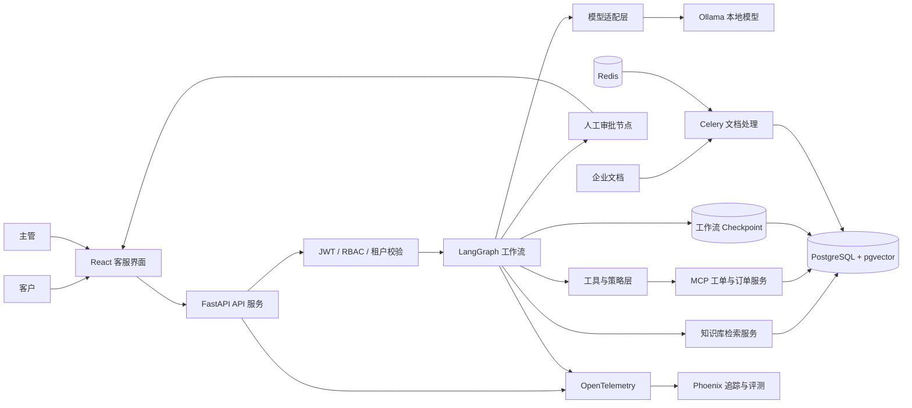
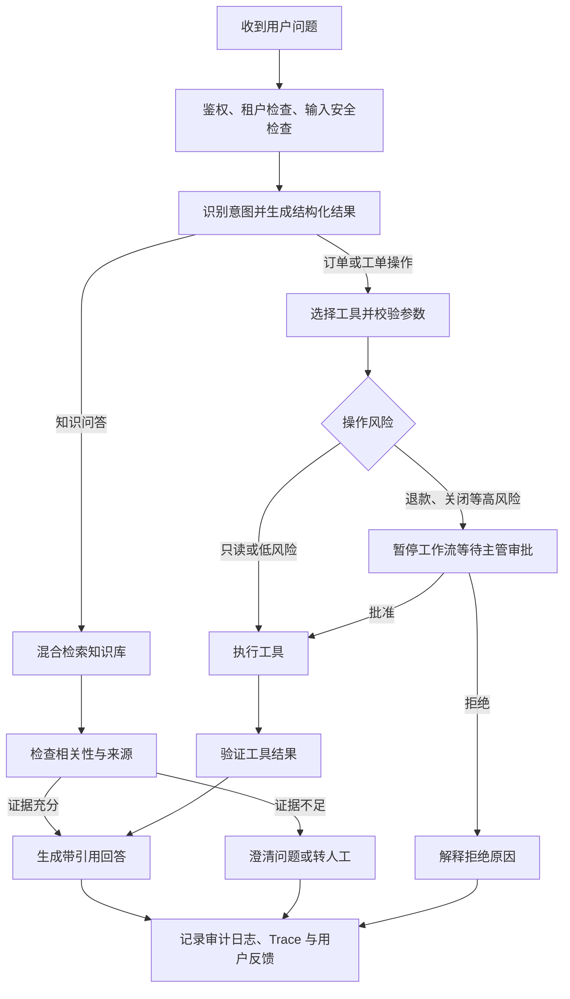

# TicketPilot 结对学习指南

> 这是 TicketPilot 项目的教学主文档，也是后续课程、编码、验收和简历材料的唯一事实来源。
>
> 当前版本：v0.1  
> 创建日期：2026-08-30  
> 当前状态：第 0 课进行中  
> 当前阶段：环境、项目目录和第一个 Python 程序

---

## 1. 怎么使用这份文档

每次学习都按以下顺序进行：

1. 先查看“当前课程”，只处理本节课的目标。
2. 老师解释这部分在整体架构中的位置和最少必备知识。
3. 老师一次提供一个完整小模块，通常包含 3–8 个连续步骤、相关命令和完整代码，不因合并教学而删减内容。
4. 学习者按顺序集中完成整个批次；普通批次完成后回复“可以了”，关键批次统一回传一次完整验收输出。
5. 不再为每个微小步骤单独停下来验证；只有报错、高风险操作或发现结果偏离预期时，才在对应步骤暂停。
6. 遇到错误时，学习者说明失败的步骤编号并回传完整错误，先分析原因再修复。
7. 每个批次末尾安排一个小变式任务或理解题，集中确认不是机械复制。
8. 批次验收通过后统一更新进度、知识点、错误记录和 Git 检查点，再进入下一批次。

### 教学边界

- 默认由学习者亲手输入项目代码。
- 老师不会在后台一次性完成整个项目。
- 老师可以创建和维护本教学文档。
- 重复、低学习价值的配置只有在学习者明确同意后，才由老师代为修改。
- 所有简历数据必须来自实际测试，禁止虚构用户量、准确率或性能收益。
- 环境版本、错误诊断、自动测试、评测指标和最终交付仍需保留可核验输出。
- 教学文档在每个批次结束时统一更新，不在每个命令之后反复修改。

### 批次教学格式

从 2026-08-31 起，每次教学默认按以下格式交付：

1. **本批次结果**：完成后会得到什么可运行成果。
2. **系统位置**：这部分处于 TicketPilot 架构的哪里。
3. **完整步骤**：一次给出 3–8 个连续步骤，标注执行顺序。
4. **完整代码**：给出本批次需要输入的全部代码，并按代码块解释；不会为了提速省略必要代码。
5. **预期结果**：列出每一步正常时应看到的关键现象。
6. **统一验收**：批次末尾只验证一次；关键节点再保留完整输出。
7. **出错方式**：学习者回复“第 N 步失败”并附完整错误，后续从该步继续，不重做已通过内容。

---

## 2. 学习者起点与目标

### 当前起点

- 看过 `hello agent` 和 `learn claude code` 等项目，了解大致流程。
- 目前不能独立阅读或编写项目代码。
- Python 几乎零基础。
- 希望通过从零搭建，而不是直接改造大型开源项目来学习。
- 每节课期望时长为 45–60 分钟。
- 模型与云服务预算尽量为零。

### 设备与环境基线

| 项目 | 当前状态 | 处理阶段 |
|---|---|---|
| 操作系统 | Windows / PowerShell | 全程 |
| GPU | RTX 4050 Laptop，6GB 显存 | 第 5 周本地模型阶段 |
| Git | 已安装，版本检查通过 | 第 0 课 |
| 当前目录 | `D:\GG-first-agent`，尚不是 Git 仓库 | 第 0 课 |
| uv | 已安装，版本检查通过 | 第 0 课 |
| Python | 已安装 CPython 3.13.2，但其目录不在 PowerShell 的 PATH 中，直接执行 `python` 会失败 | 第 0 课另由 uv 管理项目使用的 Python 3.12 |
| Docker CLI | 已安装，但读取用户配置时出现权限警告 | 第 3 周前处理 |
| Node.js / npm | 已安装，版本检查通过 | 第 15 周前端阶段 |
| Ollama | 尚未安装 | 第 5 周再安装 |

### 目标岗位

- AI 应用工程师
- Agent 工程师
- LLM / RAG 应用开发工程师
- Python 后端 + AI 工程师

### 16 周结束时的能力目标

- 能独立解释一个企业 Agent 从请求进入到返回结果的完整流程。
- 能阅读并修改 Python、FastAPI、LangGraph 和 RAG 核心代码。
- 能为 Agent 增加一个新工具，并完成参数校验、权限控制和自动测试。
- 能解释为什么高风险动作需要人工审批、持久化、幂等和审计。
- 能使用 Trace 与评测数据定位错误，而不是只靠修改 Prompt 猜测。
- 能从零启动、演示并讲解 TicketPilot。

---

## 3. 项目定义

### 项目名称

**TicketPilot：企业智能工单与知识库 Agent 平台**

### 核心业务闭环

客户提出知识问题、订单问题或售后请求。系统识别意图，检索企业知识库或调用订单与工单工具。普通查询可以自动完成；退款、关闭工单等高风险操作必须暂停并等待主管审批。整个过程保留状态、引用、工具参数、审批和审计记录。

### 第一版明确不做

- 不做复杂多 Agent 编队。
- 不做大模型训练和微调。
- 不做语音客服。
- 不做浏览器自动操作。
- 不做 Kubernetes 集群。
- 不追求大型前端系统。
- 不接入真实支付或真实企业生产数据。

第一版重点是：**可控、可恢复、可测试、可观测的单 Agent 企业工作流。**

---

## 4. 系统架构



### Agent 主流程



---

## 5. 最终技术栈

| 层级 | 技术 | 要掌握的问题 |
|---|---|---|
| Python | Python 3.12、uv | 程序如何组织、运行和管理依赖 |
| API | FastAPI、Pydantic | 请求如何进入系统，数据如何验证 |
| 数据访问 | SQLAlchemy 2、Alembic | Python 如何读写数据库，结构如何升级 |
| Agent | LangChain 1.x、LangGraph | 模型、工具与确定性流程如何协作 |
| 数据库 | PostgreSQL、pgvector | 业务数据与向量数据如何统一管理 |
| 异步任务 | Redis、Celery | 文档处理如何重试、排队和查询状态 |
| 本地模型 | Ollama | 如何零成本运行模型并切换模型提供商 |
| 工具协议 | MCP Python SDK | 工具如何被标准化发现和调用 |
| 可观测性 | OpenTelemetry、Phoenix | 如何观察模型、检索和工具执行过程 |
| 前端 | React、TypeScript、Vite | 如何提供聊天、工单和审批界面 |
| 工程化 | pytest、Docker Compose、GitHub Actions | 如何测试、交付和复现项目 |

---

## 6. 五条知识路线

### 6.1 Python 路线

- 变量与基本类型
- 条件和循环
- 函数、参数与返回值
- 列表、字典、集合
- 模块、包与导入
- 类与对象
- 异常处理
- 类型标注
- 文件与 JSON
- `async` / `await`
- 虚拟环境与依赖管理

### 6.2 后端路线

- HTTP 请求与响应
- REST API
- Pydantic 数据模型
- FastAPI 路由与依赖注入
- SQL 与关系型数据库
- ORM 与数据库迁移
- JWT、RBAC 与租户隔离
- 日志、异常和配置管理
- SSE 流式响应

### 6.3 RAG 路线

- 文档解析和清洗
- Chunk 切分与元数据
- Embedding
- 向量相似度
- pgvector 与 HNSW
- 关键词检索与向量检索
- RRF 混合检索
- 引用与无答案策略
- 检索测试集与 Hit@K

### 6.4 Agent 路线

- Message、Prompt、上下文窗口
- 结构化输出
- Tool Calling
- Agent Loop
- LangGraph State、Node、Edge
- 条件路由
- Checkpoint 与 Thread
- Human-in-the-loop
- 幂等、超时、重试和失败补偿
- MCP 工具发现与调用

### 6.5 工程化路线

- Git 小步提交
- 单元测试、集成测试、端到端测试
- Fake Model 确定性测试
- Docker 与 Compose
- CI 自动检查
- OpenTelemetry Trace
- Agent 数据集与评测
- README、架构决策记录和演示视频

---

## 7. 16 周里程碑

| 阶段 | 时间 | 可运行成果 | 关键验收 |
|---|---:|---|---|
| 准备阶段 | 第 0 周 | Python 环境和最小项目 | 能解释目录、虚拟环境和程序入口 |
| Python 基础 | 第 1–2 周 | 命令行工单系统 | 能独立修改字段和业务规则 |
| 后端基础 | 第 3–4 周 | 工单 CRUD API | Swagger 可完成登录、查询和创建 |
| 单 Agent | 第 5–6 周 | 本地模型和工具调用 | 能解释并测试 Tool Calling 循环 |
| 企业 RAG | 第 7–9 周 | 带引用的知识库问答 | 固定数据集 Hit@5 达标 |
| 工作流 | 第 10–12 周 | 可暂停、审批和恢复的 LangGraph | 重启后可以恢复待审批任务 |
| 企业增强 | 第 13–14 周 | MCP、权限、审计、Trace、评测 | 越权执行为 0，工具选择率达标 |
| 交付阶段 | 第 15–16 周 | 前端、Docker、CI、文档和演示 | 新环境按 README 可复现 |

### 建议 Git 标签

- `v0.1-cli-ticket`
- `v0.2-fastapi-crud`
- `v0.3-tool-calling`
- `v0.4-rag-citations`
- `v0.5-langgraph-hitl`
- `v0.6-mcp-observability`
- `v1.0-resume-ready`

---

## 8. 当前课程

### 当前状态

**第 0 课进行中。教学方式已改为批次模式；下一批次将一次完成重新暂存、首次提交、日志检查和干净工作区验证。**

### 第 0 课：环境、项目目录和第一个 Python 程序

#### 本课只完成

1. 理解终端、命令和工作目录。
2. 理解系统 Python 与项目 Python 的区别。
3. 使用 uv 安装和管理 Python 3.12。
4. 创建最小 Python 项目。
5. 亲手输入并运行第一个程序。
6. 理解变量、函数、参数、返回值和程序入口。
7. 初始化 Git 并完成第一次提交。

#### 本课不会做

- 不安装 FastAPI。
- 不安装 LangChain 或 LangGraph。
- 不安装数据库。
- 不安装 Ollama。
- 不编写 Agent。

#### 命令与代码

##### 检查点 0-1：确认工作目录

- PowerShell 命令：`Get-Location`
- 作用：显示终端当前所在的文件夹。
- 预期关键结果：输出路径为 `D:\GG-first-agent`。
- 实际输出：当前目录为 `C:\WINDOWS\system32`，未达到预期；学习者随后直接输入路径，PowerShell 将路径当作命令并返回 `CommandNotFoundException`。
- 修复结果：执行 `Set-Location -LiteralPath 'D:\GG-first-agent'` 后，提示符变为 `PS D:\GG-first-agent>`。
- 当前结论：目录切换成功，等待再次查询确认。

##### 检查点 0-2：验证切换结果

- PowerShell 命令：`Get-Location`
- 作用：读取当前工作目录，验证上一步的状态变化。
- 预期关键结果：`Path` 为 `D:\GG-first-agent`。
- 实际输出：`Path` 为 `D:\GG-first-agent`，检查点通过。

##### 检查点 0-3：查看目录内容

- PowerShell 命令：`Get-ChildItem -Force`
- 作用：列出当前工作目录中的文件、文件夹以及隐藏项目。
- 预期关键结果：目前至少能看到 `LEARNING_GUIDE.md`。
- 实际输出：目录中只有普通文件 `LEARNING_GUIDE.md`，大小为 20556 字节；没有项目源码和 `.git` 文件夹，检查点通过。

##### 检查点 0-4：确认 uv 可用

- PowerShell 命令：`uv --version`
- 作用：让系统查找并运行 `uv`，输出已安装版本。
- 预期关键结果：输出以 `uv` 开头并包含版本号。
- 实际输出：`uv 0.11.32 (3010295ae 2026-07-23 x86_64-pc-windows-msvc)`，检查点通过。

##### 检查点 0-5：查询 uv 已发现的 Python

- PowerShell 命令：`uv python list --only-installed`
- 作用：只查询 uv 当前能够发现的已安装 Python，不下载安装内容。
- 预期关键结果：可能没有可用 Python，也可能列出系统或 uv 管理的解释器；以实际输出为准。
- 实际输出：发现 `cpython-3.13.2-windows-x86_64-none`，解释器位于 `C:\Users\GG\AppData\Local\Programs\Python\Python313\python.exe`，检查点通过。
- 结论：Python 3.13.2 已安装，但不在 PowerShell 的 PATH 中；项目仍按计划由 uv 管理 Python 3.12。

##### 检查点 0-6：安装 Python 3.12

- PowerShell 命令：`uv python install 3.12`
- 作用：让 uv 下载并安装一个兼容的 Python 3.12 补丁版本。
- 预期关键结果：输出成功安装的 CPython 3.12.x 及其位置。
- 实际输出：40.26 秒内成功安装 `cpython-3.12.13-windows-x86_64-none (python3.12.exe)`，检查点通过。

##### 检查点 0-7：定位 Python 3.12 解释器

- PowerShell 命令：`uv python find 3.12`
- 作用：查询 uv 将使用的 Python 3.12 解释器绝对路径。
- 预期关键结果：输出一个以 `python.exe` 结尾的绝对路径。
- 实际输出：`C:\Users\GG\AppData\Roaming\uv\python\cpython-3.12-windows-x86_64-none\python.exe`，检查点通过。
- 结论：项目 Python 由 uv 独立管理，与系统已有的 Python 3.13.2 分开。

##### 检查点 0-8：初始化项目元数据

- PowerShell 命令：`uv init --bare --python 3.12`
- 作用：在当前目录创建最小 Python 项目配置，并声明项目使用 Python 3.12；不生成业务源码。
- 预期关键结果：提示项目初始化成功，目录中出现 `pyproject.toml`，并可能出现 `.python-version`。
- 实际输出：`Initialized project 'gg-first-agent'`，项目元数据初始化成功。

##### 检查点 0-9：检查初始化创建的文件

- PowerShell 命令：`Get-ChildItem -Force`
- 作用：对比初始化前后的目录内容，确认命令实际创建了什么。
- 预期关键结果：除 `LEARNING_GUIDE.md` 外，至少出现 `pyproject.toml`。
- 实际输出：目录中有 `LEARNING_GUIDE.md` 和新增的 `pyproject.toml`；没有源码文件，也没有 `.git` 文件夹。
- 学习者解释：新增文件是 `pyproject.toml`；因为没有 `.git` 文件夹，所以 Git 仓库尚未初始化。检查点通过。

##### 检查点 0-10：读取 pyproject.toml

- PowerShell 命令：`Get-Content -LiteralPath '.\pyproject.toml'`
- 作用：以只读方式显示项目配置文件的文本内容。
- 预期关键结果：看到 `[project]`、`name`、`version`、`requires-python` 和 `dependencies`。
- 实际输出：项目名为 `gg-first-agent`，项目版本为 `0.1.0`，声明支持 Python 3.12 及以上，当前依赖列表为空。
- 关键发现：`requires-python = ">=3.12"` 是兼容范围，不是解释器选择；现有 Python 3.13 也满足这个范围。
- 学习者解释：`0.1.0` 是 TicketPilot 项目版本；空依赖列表表示没有第三方库；`>=3.12` 允许 3.12 及更高版本，不能保证实际选择 3.12。检查点通过。

##### 检查点 0-11：固定项目使用 Python 3.12 系列

- PowerShell 命令：`uv python pin 3.12`
- 作用：在项目目录写入 Python 版本选择文件，使 uv 在这里优先选择 3.12。
- 预期关键结果：提示项目已固定到 `3.12`，目录中出现 `.python-version`。
- 实际输出：`Pinned '.python-version' to '3.12'`，版本选择写入成功。

##### 检查点 0-12：确认 `.python-version` 已创建

- PowerShell 命令：`Get-ChildItem -Force`
- 作用：显示普通项目，并要求 PowerShell 同时显示具有隐藏或系统属性的项目，验证版本文件存在。
- 预期关键结果：看到 `.python-version`、`LEARNING_GUIDE.md` 和 `pyproject.toml`。
- 实际输出：看到 5 字节的 `.python-version`，以及原有的 `LEARNING_GUIDE.md` 和 `pyproject.toml`。
- 学习者解释：新增文件是 `.python-version`；忘记了 `-Force` 的作用，因此增加一个对比实验。

##### 检查点 0-13：比较是否使用 `-Force`

- PowerShell 命令：`Get-ChildItem`
- 作用：不使用 `-Force` 再列出一次目录，与上一次结果比较。
- 预期关键结果：在当前 Windows 环境中，`.python-version` 很可能仍会显示，因为点号开头不等于具有 Windows 隐藏属性。
- 实际输出：不使用 `-Force` 时仍然显示 `.python-version`。
- 结论：该文件虽然以点号开头，但当前没有 Windows 隐藏属性；`-Force` 不是显示所有点号文件的必要条件，而是确保隐藏或系统项目也被包含。
- 学习者解释：因为 `.python-version` 当前不是 Windows 隐藏文件。检查点通过。

##### 检查点 0-14：读取版本选择文件

- PowerShell 命令：`Get-Content -LiteralPath '.\.python-version'`
- 作用：读取 uv 写入的版本选择值。
- 预期关键结果：输出 `3.12`。
- 实际输出：`3.12`，版本选择内容正确，检查点通过。

##### 检查点 0-15：同步项目环境

- PowerShell 命令：`uv sync`
- 作用：读取 `pyproject.toml` 和 `.python-version`，创建项目专属 `.venv`，并生成或更新依赖锁文件。
- 预期关键结果：使用 CPython 3.12.x，在当前目录创建 `.venv`；目录中可能新增 `uv.lock`。
- 实际输出：使用 CPython 3.12.13，在 `.venv` 创建虚拟环境；18ms 内解析 1 个包并完成检查，检查点通过。
- 说明：这里解析的 1 个包包含当前项目本身，不代表安装了第三方依赖。

##### 检查点 0-16：查看同步产生的项目

- PowerShell 命令：`Get-ChildItem -Force`
- 作用：确认 `.venv` 文件夹和 `uv.lock` 是否已经生成。
- 预期关键结果：看到 `.venv`、`.python-version`、`pyproject.toml`、`uv.lock` 和教学文档。
- 实际输出：看到目录 `.venv` 和文件 `uv.lock`，同时保留 `.python-version`、`pyproject.toml` 与教学文档。
- 学习者解释：`.venv` 是文件夹，`uv.lock` 是文件。检查点通过。

##### 检查点 0-17：直接运行虚拟环境解释器

- PowerShell 命令：`.\.venv\Scripts\python.exe --version`
- 作用：通过相对路径直接运行当前项目虚拟环境内的 Python。
- 预期关键结果：输出 `Python 3.12.13`。
- 实际输出：`Python 3.12.13`，虚拟环境解释器验证通过。

##### 检查点 0-18：在 PyCharm 打开项目

- 操作：使用 PyCharm 打开 `D:\GG-first-agent` 整个目录，而不是只打开某一个文件。
- 解释器：优先让 PyCharm 自动识别 `.venv\Scripts\python.exe`；如果没有识别，再手动选择现有解释器。
- 预期关键结果：项目树显示教学文档、`pyproject.toml` 和 `.python-version`；Python Interpreter 显示项目 `.venv` 中的 Python 3.12.13。
- 实际结果：PyCharm 显示项目 `gg-first-agent` 和 Python 3.12，检查点通过。

##### 检查点 0-19：创建并输入 `main.py`

- 操作位置：PyCharm 项目根目录。
- 文件名：`main.py`。
- 本步目标：第一次认识常量、函数、参数、返回值、变量、函数调用和程序入口。

```python
PROJECT_NAME = "TicketPilot"


def build_welcome_message(learner_name: str) -> str:
    message = f"{learner_name}，欢迎来到 {PROJECT_NAME}！"
    return message


def main() -> None:
    learner_name = "GG"
    welcome_message = build_welcome_message(learner_name)
    print(welcome_message)


if __name__ == "__main__":
    main()
```

- 预期运行结果：`GG，欢迎来到 TicketPilot！`
- 实际结果：PyCharm 使用 `D:\GG-first-agent\.venv\Scripts\python.exe` 运行 `D:\GG-first-agent\main.py`，输出 `GG，欢迎来到 TicketPilot！`，检查点通过。

##### 检查点 0-20：修改学习者名字

- 操作：只修改 `main()` 中 `learner_name` 右侧的字符串，换成学习者自己选择的名字；其他代码保持不变。
- 目的：验证变量值会沿着“函数参数 → f-string → 返回值 → print”传递。
- 预期结果：输出中的 `GG` 被新名字替换，项目名仍为 `TicketPilot`。
- 实际结果：学习者回复“可以了”，按教学约定视为已掌握该简单修改，检查点通过。

##### 检查点 0-21：创建 `.gitignore`

- 操作位置：PyCharm 项目根目录，与 `pyproject.toml` 同级。
- 文件名：`.gitignore`。
- 目的：阻止虚拟环境、缓存、IDE 本地配置和密钥文件进入 Git 历史。

```gitignore
.venv/
__pycache__/
*.py[cod]
.idea/
.env
```

- 预期结果：根目录出现 `.gitignore`；`.venv` 不会被 Git 跟踪。
- 实际结果：学习者回复“可以了”，按教学约定视为创建完成，检查点通过。

##### 检查点 0-22：初始化 Git 仓库

- PowerShell 命令：`git init -b main`
- 作用：在当前项目创建本地 Git 仓库，并将初始分支命名为 `main`。
- 预期关键结果：提示已初始化空 Git 仓库，目录中生成 `.git`。
- 安全边界：这一步只创建本地仓库，不会连接或上传到 GitHub。
- 实际结果：学习者回复“可以了”，按教学约定视为初始化完成。

##### 检查点 0-23：查看 Git 简洁状态

- PowerShell 命令：`git status --short`
- 作用：以简洁格式列出未跟踪、已修改和已暂存的文件。
- 预期关键结果：应看到需要提交的项目文件；不应出现 `.venv/`、`.idea/`、`.env` 或 Python 缓存。
- 证据要求：这是 Git 忽略规则的关键验收，需要回传实际输出。
- 实际结果：`.gitignore`、`.python-version`、`LEARNING_GUIDE.md`、`main.py`、`pyproject.toml` 和 `uv.lock` 显示为 `??`；未出现 `.venv`、`.idea`、`.env` 或缓存，忽略规则验收通过。
- 补充发现：PyCharm Terminal 提示符出现 `(gg-first-agent)`，表示项目虚拟环境处于激活状态。

##### 检查点 0-24：暂存当前项目文件

- PowerShell 命令：`git add .`
- 作用：把当前目录及子目录中未被忽略的变化加入 Git 暂存区。
- 安全边界：暂存不是提交，也不会上传 GitHub；暂存内容在提交前仍可检查。
- 预期结果：命令成功时通常没有输出。
- 实际结果：文件已加入暂存区；Git 对 `.python-version`、教学文档、`pyproject.toml` 和 `uv.lock` 给出 LF 将转换为 CRLF 的警告。
- 结论：暂存成功，警告来自 Windows 与仓库换行符约定尚未明确，需要增加 `.gitattributes`。

##### 检查点 0-25：创建 `.gitattributes`

- 操作位置：PyCharm 项目根目录，与 `.gitignore` 同级。
- 文件名：`.gitattributes`。
- 目的：明确文本文件在 Git 仓库中使用 LF，保证 Windows、Linux 和 Docker 环境一致。

```gitattributes
* text=auto
.gitattributes text eol=lf
.gitignore text eol=lf
.python-version text eol=lf
*.py text eol=lf
*.md text eol=lf
*.toml text eol=lf
*.lock text eol=lf
```

- 实际结果：学习者回复“可以了”，按教学约定视为创建完成。

##### 检查点 0-26：暂存 `.gitattributes`

- PowerShell 命令：`git add .gitattributes`
- 作用：把换行规则文件加入下一次提交。
- 预期结果：成功时通常没有输出。
- 实际结果：学习者回复“可以了”，按教学约定视为暂存成功。

##### 检查点 0-27：按新规则重新规范文本

- PowerShell 命令：`git add --renormalize .`
- 作用：按照 `.gitattributes` 重新计算当前目录中已跟踪或已暂存文本的标准换行形式。
- 预期结果：成功时通常没有输出。
- 实际结果：学习者回复“可以了”，按教学约定视为重新规范完成。

##### 检查点 0-28：检查提交前状态

- PowerShell 命令：`git status --short`
- 作用：确认待提交文件都位于暂存区，并验证忽略规则仍然有效。
- 预期关键结果：文件状态从 `??` 变为 `A`；应包含 `.gitattributes`，不应包含 `.venv`、`.idea` 或缓存。
- 证据要求：首次提交前的关键验收，需要回传实际输出。
- 实际结果：除教学文档为 `AM` 外，其余目标文件均为 `A`；未出现 `.venv`、`.idea` 或缓存。
- 原因：教学文档先被暂存，随后又被老师更新；`A` 表示暂存区已有新增文件，`M` 表示工作区还有未暂存修改。

##### 检查点 0-29：重新暂存教学文档

- PowerShell 命令：`git add LEARNING_GUIDE.md`
- 作用：把教学文档当前最新内容重新放入暂存区，使暂存区与工作区一致。
- 预期结果：成功时没有输出；再次查看状态时该文件应只显示 `A`。
- 实际结果：等待学习者执行并确认。

后续命令在当前检查点通过后逐步补充。一次只执行一个命令或输入 10–30 行代码。

#### 本课验收

- [ ] 能说出当前工作目录是什么。
- [ ] 能解释为什么项目不依赖全局 Python。
- [ ] 能运行最小程序并提供完整输出。
- [ ] 能解释程序中的每一个名字。
- [ ] 能独立完成一个小修改。
- [ ] 能查看 Git 状态并完成第一次提交。

---

## 9. 标准课程记录模板

后续每节课复制本模板：

```markdown
### 第 X 课：课程名称

状态：未开始 / 进行中 / 已完成 / 阻塞

#### 1. 本课结果

#### 2. 在系统中的位置

#### 3. 最少知识

#### 4. 操作步骤

步骤 1：
- 命令或代码：
- 逐行解释：
- 预期输出：
- 实际输出：

#### 5. 常见错误

#### 6. 学习者变式任务

#### 7. 理解题

#### 8. 验收结果

#### 9. Git 检查点

#### 10. 本课复盘
```

---

## 10. 进度看板

| 课程 | 状态 | 开始日期 | 完成日期 | Git 提交/标签 | 备注 |
|---|---|---|---|---|---|
| 教学指南建立 | 已完成 | 2026-08-30 | 2026-08-30 | 暂无 | 尚未初始化 Git |
| 第 0 课：环境与第一个程序 | 进行中 | 2026-08-30 |  |  | 检查点 0-1 至 0-28 已通过；当前 0-29 |
| 第 1 课：变量、输入和输出 | 未开始 |  |  |  |  |
| 第 2 课：函数与工单数据 | 未开始 |  |  |  |  |

新课程在进入对应阶段时继续添加，避免一次列出大量没有上下文的细碎任务。

---

## 11. 错误与排查记录

| 日期 | 阶段 | 现象 | 原因 | 排查过程 | 修复 | 学到什么 |
|---|---|---|---|---|---|---|
| 2026-08-30 | 环境检查 | 直接执行 `python` 时命令不存在 | CPython 3.13.2 虽已安装，但安装目录不在 PowerShell 的 PATH 中 | 使用 `uv python list --only-installed` 发现了解释器及其绝对路径 | 不修改系统 PATH；项目由 uv 单独管理 Python 3.12 | 程序已安装，不代表终端一定能通过短命令找到它 |
| 2026-08-30 | 环境检查 | Docker 读取配置文件时提示 Access denied | 待进入 Docker 阶段后确认 | 当前只验证 Docker CLI，未修改配置 | 未处理 | 不在当前阶段提前扩大问题范围 |
| 2026-08-30 | 第 0 课 | 直接输入 `D:\GG-first-agent` 后出现 `CommandNotFoundException` | PowerShell 将输入内容解析为命令，而文件夹路径本身不是命令 | 先用 `Get-Location` 确认当前目录为 `C:\WINDOWS\system32`，再检查失败命令 | 使用 `Set-Location` 显式切换目录 | “路径”和“切换到路径的命令”不是同一件事 |
| 2026-08-31 | 第 0 课 | `git add .` 提示 LF 将替换为 CRLF | Windows 与 Git 仓库尚未约定统一的文本换行格式 | 确认命令没有失败，再区分 LF 与 CRLF 的平台差异 | 添加 `.gitattributes`，将代码和配置在仓库中统一为 LF | 警告不等于失败，但跨平台项目应明确换行策略 |

---

## 12. 测试与评测看板

当前尚未进入测试阶段，所有指标标记为“未测量”。

| 指标 | 最终目标 | 当前结果 | 数据集规模 | 证据位置 |
|---|---:|---:|---:|---|
| 知识检索 Hit@5 | ≥ 85% | 未测量 | 0 | 待建立 |
| 工具选择准确率 | ≥ 90% | 未测量 | 0 | 待建立 |
| 工具参数正确率 | ≥ 90% | 未测量 | 0 | 待建立 |
| 跨租户越权成功数 | 0 | 未测量 | 0 | 待建立 |
| 高风险未审批执行数 | 0 | 未测量 | 0 | 待建立 |
| 重复退款执行数 | 0 | 未测量 | 0 | 待建立 |
| 重启后工作流恢复 | 100% 通过固定场景 | 未测量 | 0 | 待建立 |

### 最终必须覆盖的场景

- 正常知识问答、无答案、冲突文档和提示注入。
- 正确工具、错误工具、参数缺失、超时和重复调用。
- 未登录、跨租户访问、普通客服尝试批准退款。
- 审批通过、拒绝、修改参数后批准、服务重启后恢复。
- 文档重复上传、解析失败、异步任务重试。
- 模型不可用时的降级结果。
- Fake Model 确定性测试与本地模型端到端评测。

---

## 13. 最终核心接口

这些接口是最终方向，不会在早期课程一次性实现：

| 方法与路径 | 用途 |
|---|---|
| `POST /v1/chat/stream` | 创建或继续 Agent 会话，返回流式事件 |
| `POST /v1/documents` | 上传文档并启动异步处理 |
| `GET /v1/jobs/{job_id}` | 查询文档处理任务状态 |
| `GET /v1/tickets/{ticket_id}` | 查询工单 |
| `POST /v1/runs/{thread_id}/decision` | 批准、修改或拒绝待审批操作 |
| `GET /v1/runs/{thread_id}` | 查看工作流当前状态与历史 |
| `POST /v1/feedback` | 保存用户对回答的反馈 |

### 最终核心数据类型

- `AgentState`
- `IntentResult`
- `Citation`
- `ToolRequest`
- `ApprovalRequest`
- `ApprovalDecision`
- `Ticket`
- `AuditEvent`

所有接口、工作流和工具应共享明确的数据模型，避免任意字典和无法验证的字符串在系统中传播。

---

## 14. 简历证据清单

在真实完成前，以下内容都不能写入简历：

- [ ] 可访问的 GitHub 仓库。
- [ ] 清晰的 README 与本地启动步骤。
- [ ] 系统架构图和 Agent 流程图。
- [ ] API 文档。
- [ ] 自动测试报告。
- [ ] RAG 与工具调用评测报告。
- [ ] 人工审批和故障恢复演示。
- [ ] Phoenix Trace 截图或演示。
- [ ] Docker Compose 一键启动。
- [ ] 3–5 分钟项目演示视频。
- [ ] 至少一份架构决策记录。
- [ ] 学习者能够现场增加一个新工具。

### 最终简历描述模板

> 仅作为结构，数字必须替换为实际测量结果。

- 从零设计并实现企业智能工单与知识库 Agent，使用 LangGraph 构建可持久化、可暂停和可恢复的业务工作流。
- 基于 PostgreSQL 全文检索与 pgvector 构建混合 RAG，在自建数据集上达到实际测得的 Hit@5 指标，并为回答提供可追溯引用。
- 为退款等高风险工具实现 RBAC、人工审批、幂等和审计机制，通过自动化测试验证未授权执行为 0。
- 使用 OpenTelemetry 与 Phoenix 追踪模型、检索和工具调用，并基于固定测试集持续评估 Agent 行为。

---

## 15. 面试准备区

以下问题必须由学习者在项目过程中逐步形成自己的答案：

1. 为什么第一版使用单 Agent，而不是多 Agent？
2. 为什么业务流程使用 LangGraph，而不是只写一个 `while` 循环？
3. RAG 与普通数据库查询有什么区别？
4. 为什么向量检索还需要关键词检索？
5. 如何阻止 Agent 未经审批执行退款？
6. 工作流暂停后，服务重启为什么还能继续？
7. 幂等与数据库事务分别解决什么问题？
8. 如何判断 Agent 变得更好，而不是“看起来回答不错”？
9. MCP 与 Agent 框架的职责有什么不同？
10. 本地小模型效果不足时，架构如何切换到商业模型？

回答必须包含项目中的实际代码位置、测试或 Trace 证据。

---

## 16. 技术术语表

| 术语 | 当前理解 | 掌握状态 |
|---|---|---|
| 工作目录 | 终端命令当前作用的文件夹 | 待第 0 课确认 |
| Python 解释器 | 执行 Python 源代码的程序 | 待学习 |
| uv | 独立于 Python 语言的项目管理工具，用于安装 Python、创建虚拟环境、管理依赖和运行项目 | 初步理解 |
| 虚拟环境 | 为单个项目隔离 Python 与依赖 | 待学习 |
| API | 系统之间约定好的调用接口 | 待学习 |
| RAG | 先检索外部证据，再让模型基于证据生成 | 待学习 |
| Embedding | 将内容转换为可比较的数值向量 | 待学习 |
| Tool Calling | 模型生成结构化工具请求，由程序实际执行 | 待学习 |
| Agent State | 工作流在某一时刻需要保存的数据 | 待学习 |
| Checkpoint | 工作流步骤完成后保存的状态快照 | 待学习 |
| Human-in-the-loop | 在关键节点暂停并让人做决定 | 待学习 |
| 幂等 | 同一请求执行多次仍只产生一次业务效果 | 待学习 |
| Trace | 一次请求经过的模型、检索、工具和节点记录 | 待学习 |
| MCP | AI 应用发现和调用外部工具与资源的协议 | 待学习 |

---

## 17. 重点源码索引

当前没有项目源码。每创建一个重要模块，就在这里记录它的职责和学习顺序。

| 文件 | 职责 | 首次学习课程 | 是否能独立解释 |
|---|---|---|---|
| 暂无 | 尚未开始编码 |  |  |

---

## 18. 决策记录

| 日期 | 决策 | 原因 | 以后何时复查 |
|---|---|---|---|
| 2026-08-30 | 选择智能工单与知识库场景 | 业务边界清晰，可覆盖 RAG、工具、审批、权限和评测 | 完成第 6 周后 |
| 2026-08-30 | 第一版使用单 Agent + 显式工作流 | 降低入门难度，优先学习可靠性与可控性 | 完成 LangGraph 阶段后 |
| 2026-08-30 | 学习者亲手输入代码 | 确保能够阅读、解释和现场修改 | 每节课复盘 |
| 2026-08-30 | 默认本地模型和本地服务 | 控制费用，并训练模型适配能力 | 模型效果无法满足评测时 |
| 2026-08-30 | 不提前处理 Docker 警告 | 当前阶段用不到 Docker，避免分散注意力 | 第 3 周前 |
| 2026-08-30 | 保持最初的 16 周完整企业版，不压缩为 4 周或 6 周版本 | 学习目标是亲手完成并真正理解完整企业架构，而不是为了短期完工删减关键能力 | 每个阶段结束后只复查学习进度，不删减最终目标 |
| 2026-08-30 | 普通步骤允许用“可以了”确认掌握 | 减少重复粘贴输出，把时间用于理解与编码；关键验收仍保留证据 | 出现理解偏差或关键质量节点时 |
| 2026-08-31 | 改为批次教学，一次提供多个连续步骤和完整相关代码 | 原逐命令验证方式过慢；保留全部知识与代码，只减少来回确认和重复思考时间 | 每个阶段复盘学习效果与单批次信息量 |

---

## 19. 参考资料

- [LangGraph 官方概览](https://docs.langchain.com/oss/python/langgraph/overview)
- [LangGraph 持久化](https://docs.langchain.com/oss/python/langgraph/persistence)
- [LangChain Human-in-the-loop](https://docs.langchain.com/oss/python/langchain/human-in-the-loop)
- [LangChain Structured Output](https://docs.langchain.com/oss/python/langchain/structured-output)
- [pgvector 官方仓库](https://github.com/pgvector/pgvector)
- [MCP 官方架构](https://modelcontextprotocol.io/docs/learn/architecture)
- [Ollama Structured Outputs](https://docs.ollama.com/capabilities/structured-outputs)
- [Phoenix 官方文档](https://arize.com/docs/phoenix/)

参考资料按课程需要阅读，不要求现在一次看完。

---

## 20. 下一步

请先完整阅读本文件。确认教学方式、项目目标和第 0 课范围都符合预期后，回复：

> 开始第 0 课

在收到这句话之前，不创建项目源码、不初始化 Git、不安装 Python 或其他依赖。
