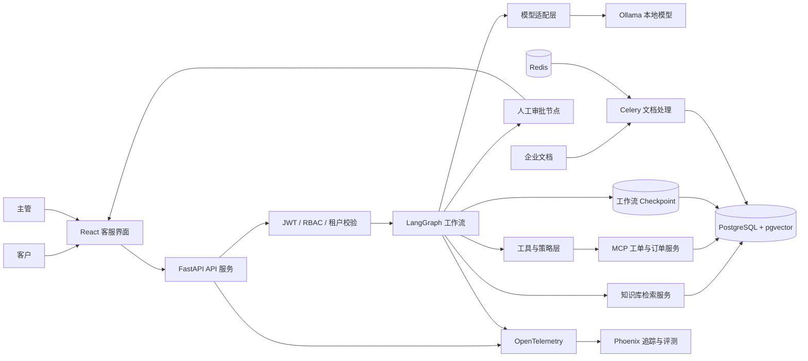
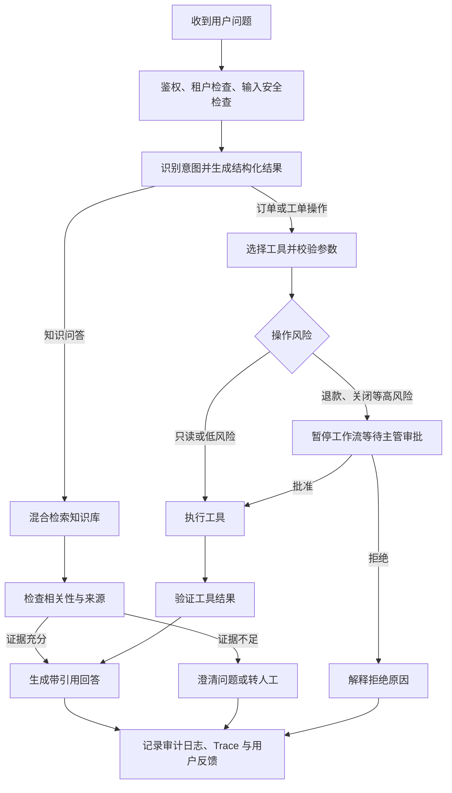

# TicketPilot 结对学习指南

> 这是 TicketPilot 项目的教学主文档，也是后续课程、编码、验收和简历材料的唯一事实来源。
>
> 当前版本：v0.1  
> 创建日期：2026-08-30  
> 当前状态：2026-11-14，按11月20日面试演示版计划推进；新核心代码与部署配置由学习者手写，老师先逐项解释；测试及已授权的重复接线由老师处理并解释。
> 当前阶段：审批/工作流/受控Agent/MCP、审计和HTTP/步骤Trace已接入，最近相关pytest836项通过。后端镜像及独立Compose的数据库、迁移、后端已运行；真实PostgreSQL临时库的API/幂等/审计/stdio MCP验证通过，模型为替身。两个演示角色账号及真实登录权限验证完成；前端容器与Nginx代理已通过运行验证；Worker与真实文件入库已验证，三题问答按学习者反馈验收；GitHub前端CI通过、后端CI待修复，最终评测与面试材料待收尾；审批前端暂缓。证据与边界见“当前课程”，不当作全项目或生产验收。

---

## 1. 怎么使用这份文档

每次学习都按以下顺序进行：

1. 先查看“当前课程”，只处理本节课的目标。
2. 老师先讲解上一批理解题的答案和原因，再解释本批次在整体架构中的位置和最少必备知识；学习者只回复“可以了”时，也按这个顺序继续。
3. 老师一次提供一个完整小模块，通常包含 3–8 个连续步骤、相关命令和完整代码，不因合并教学而删减内容。
4. 学习者按顺序集中完成整个批次；普通批次完成后回复“可以了”，关键批次统一回传一次完整验收输出。
5. 不再为每个微小步骤单独停下来验证；只有报错、高风险操作或发现结果偏离预期时，才在对应步骤暂停。
6. 遇到错误时，学习者说明失败的步骤编号并回传完整错误，先分析原因再修复。
7. 每个批次结尾固定提出一个与本批代码有关的理解题；下一次开头先解释答案和原因，再继续新内容。学习者已作答时，结合其答案说明理解正确的地方与需要纠正的地方。
8. 批次验收通过后统一更新进度、知识点、错误记录和 Git 检查点，再进入下一批次。

### 教学边界

- 2026-11-12学习者明确补充：每遇到一个新的大知识点，必须先详细解释，不能仅用简短介绍后立即给项目代码。后续MCP、审计、OpenTelemetry/Trace、Docker、CI等均先讲业务问题、基本概念、完整调用过程、与已有技术的关系、项目位置、边界和面试表达，再进入实现。当前暂停MCP安装/Server录入要求，先完整讲解MCP；不因11月20日目标省略新知识理解环节。

文件说明约定（2026-10-28 补充）：以后给出的新文件，必须在开头用中文说明它负责什么、解决什么问题、由谁使用或与哪些文件配合，以及不负责什么。函数和参数继续保留中文用途说明；首次出现的 Python、JavaScript 或 TypeScript 语法、内置方法和库方法要解释。已有文件优先提供准确的局部修改位置。严格 JSON、锁文件、图片等不直接插入代码注释，其用途放到相应 README 中。

- 新知识、新 API、新工具和新机制由老师先讲原理并提供带中文注释的代码，学习者亲手输入；重复的导入、样式、公共逻辑与已学接线可由老师处理，并解释关键改动。
- 老师不会在后台一次性完成整个项目。
- 老师可以创建和维护本教学文档。
- 重复、低学习价值的配置只有在学习者明确同意后，才由老师代为修改。
- 所有简历数据必须来自实际测试，禁止虚构用户量、准确率或性能收益。
- 环境版本、错误诊断、自动测试、评测指标和最终交付仍需保留可核验输出。
- 教学文档在每个批次结束时统一更新，不在每个命令之后反复修改。
- 2026-11-03 学习者反馈 React 概念尚未理清：历史版本查看这一段收尾后，先暂停项目功能推进，补 React 基础，再由学习者决定何时恢复。补课先用简短例子讲清组件、JSX、props、state 与重新渲染，再逐步回看现有项目中的 effect、ref、自定义 Hook、路由和查询缓存；每次集中处理一个主题。
- 2026-11-03 学习者进一步说明“没怎么学过前端”：补课从 HTML、CSS、JavaScript 开始，再补必要的 TypeScript 基础，最后进入 React；不默认已掌握网页基础。
- 补课方式后续已按学习者要求调整：直接讲概念、展示短代码及执行/显示结果，不要求创建练习文件、保存、运行或截图；每批讲约 3–5 个相关知识点，减少等待和来回确认，继续采用“结尾一题、下次开头解释”的节奏。项目编码恢复后仍由学习者手写，基础补课的免建文件约定不表示自动代写项目源码。

### 批次教学格式

从 2026-08-31 起，每次教学默认按以下格式交付：

1. **本批次结果**：完成后会得到什么可运行成果。
2. **系统位置**：这部分处于 TicketPilot 架构的哪里。
3. **新概念预讲**：任何第一次出现的语法、类型、库、框架能力或工程概念，都先解释它解决什么问题、有什么用、基本写法和最小示例。
   - 学习者有 Java 基础；讲解 Python 新概念时优先增加 Java 对照，并明确相似点和关键差异。
4. **完整步骤**：确认新概念有基本认识后，一次给出 3–8 个连续步骤，标注执行顺序。
5. **完整代码**：新概念解释完后再给本批次全部代码；不会为了提速省略必要代码，改名时同步更新所有调用，每个函数前保留职责注释。
6. **运行示例**：完整展示一组用户输入、程序分支和最终输出。
7. **预期结果**：列出每一步正常时应看到的关键现象。
8. **统一验收**：批次末尾只验证一次；关键节点再保留完整输出。
9. **出错方式**：学习者回复“第 N 步失败”并附完整错误，后续从该步继续，不重做已通过内容。

“新概念”包括但不限于：新的 Python 关键字和语法、新的容器或类型标注、新导入的标准库或第三方库、文件和数据库操作、异常处理、异步代码、框架装饰器、Agent 状态和工具协议。已经讲过且行为没有变化的内容不重复展开。

---

## 2. 学习者起点与目标

### 当前起点

- 看过 `hello agent` 和 `learn claude code` 等项目，了解大致流程。
- 目前不能独立阅读或编写项目代码。
- Python 几乎零基础。
- 希望通过从零搭建，而不是直接改造大型开源项目来学习。
- 每节课期望时长为 45–60 分钟。
- 模型与云服务预算尽量为零。

### 设备与环境基线

| 项目 | 当前状态 | 处理阶段 |
|---|---|---|
| 操作系统 | Windows / PowerShell | 全程 |
| GPU | RTX 4050 Laptop，6GB 显存 | 第 5 周本地模型阶段 |
| Git | 已安装，版本检查通过 | 第 0 课 |
| 当前目录 | `D:\GG-first-agent`，尚不是 Git 仓库 | 第 0 课 |
| uv | 已安装，版本检查通过 | 第 0 课 |
| Python | 已安装 CPython 3.13.2，但其目录不在 PowerShell 的 PATH 中，直接执行 `python` 会失败 | 第 0 课另由 uv 管理项目使用的 Python 3.12 |
| Docker CLI | 已安装，但读取用户配置时出现权限警告 | 第 3 周前处理 |
| Node.js / npm | 已安装，版本检查通过 | 第 15 周前端阶段 |
| Ollama | 尚未安装 | 第 5 周再安装 |

### 目标岗位

- AI 应用工程师
- Agent 工程师
- LLM / RAG 应用开发工程师
- Python 后端 + AI 工程师

### 16 周结束时的能力目标

- 能独立解释一个企业 Agent 从请求进入到返回结果的完整流程。
- 能阅读并修改 Python、FastAPI、LangGraph 和 RAG 核心代码。
- 能为 Agent 增加一个新工具，并完成参数校验、权限控制和自动测试。
- 能解释为什么高风险动作需要人工审批、持久化、幂等和审计。
- 能使用 Trace 与评测数据定位错误，而不是只靠修改 Prompt 猜测。
- 能从零启动、演示并讲解 TicketPilot。

---

## 3. 项目定义

### 项目名称

**TicketPilot：企业智能工单与知识库 Agent 平台**

### 核心业务闭环

客户提出知识问题、订单问题或售后请求。系统识别意图，检索企业知识库或调用订单与工单工具。普通查询可以自动完成；退款、关闭工单等高风险操作必须暂停并等待主管审批。整个过程保留状态、引用、工具参数、审批和审计记录。

### 第一版明确不做

- 不做复杂多 Agent 编队。
- 不做大模型训练和微调。
- 不做语音客服。
- 不做浏览器自动操作。
- 不做 Kubernetes 集群。
- 不追求大型前端系统。
- 不接入真实支付或真实企业生产数据。

第一版重点是：**可控、可恢复、可测试、可观测的单 Agent 企业工作流。**

---

## 4. 系统架构



### Agent 主流程



---

## 5. 最终技术栈

| 层级 | 技术 | 要掌握的问题 |
|---|---|---|
| Python | Python 3.12、uv | 程序如何组织、运行和管理依赖 |
| API | FastAPI、Pydantic | 请求如何进入系统，数据如何验证 |
| 数据访问 | SQLAlchemy 2、Alembic | Python 如何读写数据库，结构如何升级 |
| Agent | LangChain 1.x、LangGraph | 模型、工具与确定性流程如何协作 |
| 数据库 | PostgreSQL、pgvector | 业务数据与向量数据如何统一管理 |
| 异步任务 | Redis、Celery | 文档处理如何重试、排队和查询状态 |
| 本地模型 | Ollama | 如何零成本运行模型并切换模型提供商 |
| 工具协议 | MCP Python SDK | 工具如何被标准化发现和调用 |
| 可观测性 | OpenTelemetry、Phoenix | 如何观察模型、检索和工具执行过程 |
| 前端 | React、TypeScript、Vite | 如何提供聊天、工单和审批界面 |
| 工程化 | pytest、Docker Compose、GitHub Actions | 如何测试、交付和复现项目 |

---

## 6. 五条知识路线

### 6.1 Python 路线

- 变量与基本类型
- 条件和循环
- 函数、参数与返回值
- 列表、字典、集合
- 模块、包与导入
- 类与对象
- 异常处理
- 类型标注
- 文件与 JSON
- `async` / `await`
- 虚拟环境与依赖管理

### 6.2 后端路线

- HTTP 请求与响应
- REST API
- Pydantic 数据模型
- FastAPI 路由与依赖注入
- SQL 与关系型数据库
- ORM 与数据库迁移
- JWT、RBAC 与租户隔离
- 日志、异常和配置管理
- SSE 流式响应

### 6.3 RAG 路线

- 文档解析和清洗
- Chunk 切分与元数据
- Embedding
- 向量相似度
- pgvector 与 HNSW
- 关键词检索与向量检索
- RRF 混合检索
- 引用与无答案策略
- 检索测试集与 Hit@K

### 6.4 Agent 路线

- Message、Prompt、上下文窗口
- 结构化输出
- Tool Calling
- Agent Loop
- LangGraph State、Node、Edge
- 条件路由
- Checkpoint 与 Thread
- Human-in-the-loop
- 幂等、超时、重试和失败补偿
- MCP 工具发现与调用

### 6.5 工程化路线

- Git 小步提交
- 单元测试、集成测试、端到端测试
- Fake Model 确定性测试
- Docker 与 Compose
- CI 自动检查
- OpenTelemetry Trace
- Agent 数据集与评测
- README、架构决策记录和演示视频

---

## 7. 16 周里程碑

| 阶段 | 时间 | 可运行成果 | 关键验收 |
|---|---:|---|---|
| 准备阶段 | 第 0 周 | Python 环境和最小项目 | 能解释目录、虚拟环境和程序入口 |
| Python 基础 | 第 1–2 周 | 命令行工单系统 | 能独立修改字段和业务规则 |
| 后端基础 | 第 3–4 周 | 工单 CRUD API | Swagger 可完成登录、查询和创建 |
| 单 Agent | 第 5–6 周 | 本地模型和工具调用 | 能解释并测试 Tool Calling 循环 |
| 企业 RAG | 第 7–9 周 | 带引用的知识库问答 | 固定数据集 Hit@5 达标 |
| 工作流 | 第 10–12 周 | 可暂停、审批和恢复的 LangGraph | 重启后可以恢复待审批任务 |
| 企业增强 | 第 13–14 周 | MCP、权限、审计、Trace、评测 | 越权执行为 0，工具选择率达标 |
| 交付阶段 | 第 15–16 周 | 前端、Docker、CI、文档和演示 | 新环境按 README 可复现 |

### 建议 Git 标签

- `v0.1-cli-ticket`
- `v0.2-fastapi-crud`
- `v0.3-tool-calling`
- `v0.4-rag-citations`
- `v0.5-langgraph-hitl`
- `v0.6-mcp-observability`
- `v1.0-resume-ready`

---

## 8. 当前课程

2026-11-14第二次远端CI实际结果：用户修复并推送c0c8b44，远端main一致；run43600842541已正常创建两job，Frontend checks测试/lint/build全部success。Backend checks在Install dependencies失败，Run backend tests skipped；日志明确No interpreter found for Python 3.12.16 in managed installations or search path并提示uv内置下载清单可能需更新。固定uv0.11.32的本机可下载3.12目录不含3.12.16；该观察为Windows元数据，不宣称完整Linux安装验收。提供由学习者修改CI为python-version 3.12，并在sync前显式uv python install 3.12，允许使用工具已支持的3.12补丁版本；不改本机解释器、Dockerfile或uv.lock。内存候选YAML结构与步骤顺序检查通过，未代写配置、未提交/推送。当前远端前端CI已通过，后端测试未执行，整个CI未通过。理解题：为什么Install dependencies失败后，Run backend tests显示skipped而不是failure？

2026-11-14首次远端CI核对：本地main提交3e504b7已成功推送，git ls-remote确认远端同SHA，origin地址正确且上游origin/main。通过已有Git认证只读访问GitHub API，凭据仅内存使用未打印/落盘；run43600290523为completed/failure、jobs为空，check-suite亦无check-run注释。检查配置并核对GitHub官方Context availability，发现老师此前示例在jobs.backend.env引用runner.temp，该位置不支持runner；需由学习者移两项路径到Run backend tests步骤env（此处支持runner）。在内存中验证候选YAML结构与测试命令不变，未改CI文件/索引/远端，不宣称已修复或CI通过；该配置错误与零job现象一致，未取得平台原始校验注释。提供修改、单独提交和push后查看最新run步骤。原.env.example与.gitattributes仍为未纳入提交的本机修改，保留。理解题：修复配置后，为什么要看新提交的CI记录，而不是重新运行旧提交的失败记录？

2026-11-14首次推送教学准备：学习者已重新暂存当前项目，根CI配置、依赖锁文件和主要部署/源码均在索引中。核对暂存361个新增/修改文件与工作区内容一致（忽略CRLF差异），无.env/演示凭据/data/tmp/venv/node_modules/dist进入本次暂存清单；tmp未跟踪候选0。用户创建并提供https://github.com/GG-777-GG/TicketPilot，当前main且仍未配置远程。格式检查发现9处文件末尾多余空行，老师仅清理这些空行，未改代码逻辑、未更新索引；教学文档亦需学习者重新暂存。指导学习者更新快照、检查cached、配置origin、提交并push -u origin main，在GitHub Actions查看两job。老师未配置远程、提交或推送，远端CI尚无运行证据；不因纯空行重跑已通过测试。理解题：git commit和git push分别把代码保存到了哪里？

2026-11-14 CI根目录检查通过并进入Git提交准备：根.github/workflows/ci.yml已存在，旧frontend/.github/workflows/ci.yml已从工作区移走；触发器/两job/依赖路径结构检查通过，尚无远端CI结果。只读Git检查：未配置任何远程地址，当前main；135个既有暂存变更中有124个空文件快照（不代表工作区代码丢失），AM/AD状态需重新暂存当前内容及删除。按实际未跟踪文件清单复核，tmp内约3260个临时文件仍为候选，不能仅凭git check-ignore对目录的返回码判定其已忽略；根.gitignore尚无/tmp/规则。指导学习者添加/tmp/、用明确源码/测试/配置路径git add更新快照，再检查cached stat及敏感/运行目录为空。老师本轮不修改忽略配置或Git索引，不提交/推送；已询问学习者是否已有GitHub仓库及其地址。理解题：为什么只执行git commit，而不重新git add，仍可能提交到空文件或旧代码？

2026-11-14 CI录入检查：实际文件位于frontend/.github/workflows/ci.yml，仓库根.github/workflows/ci.yml不存在。PyYAML按BaseLoader检查触发器、两job、step结构及6个测试目录/前端锁文件路径均正确；此检查不等同GitHub校验或远端执行。GitHub只在仓库根.github/workflows发现工作流，需学习者将现有文件移到根目录，内容无需重写。发现已有135个暂存变更，CI暂存内容与工作区不同，存在AM等状态；老师未修改暂存区、移动配置、提交或推送。指导学习者先修正路径，再核对实际提交快照和依赖文件，避免只提交CI而遗漏尚未跟踪的项目源码。理解题：为什么frontend job的working-directory: frontend不能让GitHub识别frontend/.github/workflows/ci.yml？

2026-11-14知识问答与CI教学：学习者对有依据/无依据/部分依据三题回复可以了，按用户反馈记录手工验收完成，老师未读取三题原始响应，不新增准确率或延迟结论。进入GitHub Actions持续集成，区别于LangGraph业务工作流；部署/CI配置由学习者手写。拟新增.github/workflows/ci.yml：push/pull_request/workflow_dispatch，两独立Ubuntu job，后端Python3.12.16、uv0.11.32、锁文件同步和6目录隔离单测，前端Node24、npm ci/test/lint/build。不使用真实数据库/Ollama/本机凭据。老师本机实测拟选后端228 passed in 3.45s，前端12项测试、lint及生产构建通过；不是GitHub/Linux CI结果，也不与历史836项叠加。尚未创建CI文件、提交或推送。理解题：为什么CI应使用临时数据库和模型替身，而不连接本机演示数据库与Ollama？

2026-11-14正确演示入口入库完成：学习者确认此前误用旧网址，改用18080。老师只读演示库确认1条文件入库任务succeeded、attempt_count=1，1篇文档、1个知识片段。该结果证明已有真实入库成功，不再只是Worker启动证据；本次未读取正文、未执行问答推理，不宣称三题RAG验收已通过。下一批由学习者在18080知识库问答模式验证有依据、无依据和部分依据三题，保留来源与失败情况。理解题：为什么检索到相关片段，不等于片段能支持问题中的每一个事实？

2026-11-14动态DNS修复录入核对：学习者已添加ticketpilot_api共享zone、Docker resolver与server resolve，并重建frontend。nginx -t通过，实际18080/v1/auth/me由502恢复为未携带令牌时预期的401；未主动重建backend验证下一次IP切换。Compose五服务状态正常（migrate退出0、database/backend健康、frontend/worker运行）。只读确认演示库入库任务0、文档0、片段0，因此尚无真实入库/问答成功证据。下一批学习者在18080环境上传演示TXT并验收有依据/部分缺失/无依据三类问答，避免误用5173旧开发环境；不宣称固定题评测已完成。理解题：为什么文档ready不能保证任意问题都有答案？

2026-11-14Worker启动核对：学习者已手写worker服务及backend显式上传目录。Compose静态校验通过，Worker处于Up且启动标记存在，API/Worker挂载同一ticketpilot-demo_demo_app_data到/app/data。只读演示库任务状态统计为空，尚无真实文件入库成功证据。后端因配置更新重建后，前端/v1/auth/me实测502：Nginx错误中的旧上游172.21.0.3:8000，当前backend为172.21.0.5。上一版静态proxy_pass缺少动态DNS更新，需要学习者改为共享zone+Docker resolver+upstream server resolve，再重建前端验收入库。当前Nginx1.30.6支持该语法；尚未应用修复，不能宣称问题已解决。理解题：为什么改完宿主机nginx.conf后，执行容器restart不会自动使用新配置？

2026-11-14前端容器验收：学习者手写frontend/nginx.conf、frontend/Dockerfile与Compose frontend段。老师只读确认Compose配置通过、frontend运行于127.0.0.1:18080、Nginx语法正确；实际HTTP验证/login与/tickets返回React入口、构建JS可读、缺失assets返回404、两角色通过Nginx登录及auth/me身份正确。不宣称浏览器端所有交互自动验收。下一批由学习者手写Worker服务：复用后端镜像、覆盖command为现有worker_cli --watch、同数据库/上传目录/数据卷和宿主机Ollama；尚未录入或启动Worker。理解题：为什么API和Worker即使连接同一个数据库，也仍然必须共享上传文件卷？

2026-11-14教学偏好调整：学习者明确要求配置也亲手编写。下一批讲解前端生产部署、Nginx反向代理/SPA回退与多阶段构建，提供frontend/nginx.conf、frontend/Dockerfile及Compose新增frontend段的带注释示例，由学习者录入。老师本轮只读取现有配置及更新本教学记录，未创建这些部署文件、未构建或启动前端容器，实际验收待后续。上一题解释：公开注册若可自报supervisor会绕过角色授权，可信本机初始化与公共注册必须分开。理解题：为什么Nginx容器应转发到backend:8000，而不是127.0.0.1:18000？

2026-11-14演示账号：新增scripts/bootstrap_demo_accounts.py，仅向ticketpilot-demo创建agent.demo@example.com客服与supervisor.demo@example.com主管。随机密码保存在Git/Docker忽略的.env.demo.accounts，库中仅存哈希；重复执行核对并保留账号，角色/密码/停用状态冲突则整批回滚。实际18000登录及auth/me通过，客服审计403、主管200；重复执行零写入、凭据文件不变，第二账号冲突时首个探针插入回滚且未残留。未操作原业务库；未重跑历史836项pytest。下一批为前端容器/Nginx与Worker编排。

### 当前状态

2026-11-14独立Compose实际验收：学习者配置静态检查通过，启动全新ticketpilot-demo项目、独立数据库/app卷及本机18000端口。PostgreSQL18.6/pgvector0.8.6、迁移head及backend健康通过，migrate正常Exited(0)。当前容器DNS不识别host.docker.internal，老师仅给backend补extra_hosts host-gateway；验证可连接宿主机Ollama0.40.14、所需聊天/向量模型已安装，只读元数据，无真实推理、不修改宿主机监听。UID/GID10001写入自己的卷探针，backend重建后内容保留并删除探针。新增scripts/check_demo_postgres.py，检查固定项目/目标库，再建立唯一临时PostgreSQL库，执行迁移、真实JWT HTTP审批/拒绝/工作流恢复/幂等/审计和真实stdio MCP六Span链路；模型与向量替身，临时库/检查点清理。补临时库目标保护后复验通过，临时库计数0。宿主机health和Swagger18000可达，演示服务保持运行，未操作原业务栈或演示业务行，未重跑836项pytest。理解题：为什么migrate显示Exited(0)，却不表示部署失败？

2026-11-14独立Compose手写批：先解释database健康→migrate退出0→backend启动，service_healthy与service_completed_successfully不同，数据库运行不代表表已迁移，依赖条件只约束启动。提供学习者手写新compose.demo.yaml（name ticketpilot-demo），复用已验证镜像、数据库仅内网、新demo_postgres_data/demo_app_data卷、backend本机18000端口、单worker默认命令及init子进程回收，宿主机Ollama地址采用Docker Desktop主机名。现有compose.yaml/业务卷不改。老师新增scripts/init_demo_env.py、先忽略.env.demo，再独占创建本机随机数据库/JWT凭据，值未打印；再次执行确认原内容不变。示例通过stdin执行Compose config --quiet静态校验，不启动容器、不打印展开密钥；compose.demo.yaml尚未代写，真实PG迁移/卷权限/Ollama连接尚待下一轮隔离验证。理解题：为什么数据库healthy后，还需要等待migrate成功才能启动backend？

2026-11-14后端镜像验收完成：学习者Dockerfile录入正确。首次构建因deb.debian.org DNS失败中止，用户说明正在使用代理/VPN；老师在临时容器验证可达源后，新增DEBIAN_MIRROR/DEBIAN_SECURITY_MIRROR构建参数（默认官方HTTPS）、超时重试，本次主源用USTC、安全源仍官方。files.pythonhosted.org在构建中解析失败，使用宿主机实时解析的IPv4通过本次build --add-host绕过；未改全局代理/DNS或写死IP。镜像ticketpilot-backend:interview-check（linux/amd64）实际构建成功，BuildKit静态检查无警告。新增scripts/check_backend_image.py，实际无外网/无发布端口/无挂载的唯一临时容器验证UID/GID10001、Linux虚拟环境和data写权限、凭据排除、依赖兼容、OpenCV/ONNX/PDFium、离线RapidOCR初始化、打包迁移在临时SQLite升级head、health/OpenAPI及请求/Trace头全部通过；测试和网络探针容器均已清理。部署步骤与记录见DEPLOYMENT.md。未连接既有业务库/卷或真实Ollama，未运行完整Compose，未重跑历史836项组合。下一批接后端Compose、隔离数据库及持久化；本批理解题：为什么Docker镜像构建成功，还需要实际启动容器检查？

2026-11-14后端Dockerfile手写批：核对uv 0.11.32、Docker 29.6.1、Compose v5.1.4，仅版本命令，不代表daemon/build验收。项目锁定Python依赖含OCR/OpenCV/ONNX，RapidOCR包manifest包含3个ONNX模型文件。老师新增根.dockerignore排除本机venv/env/业务数据/临时文件和缓存，不删除文件或修改Compose。提供学习者手写Dockerfile：python:3.12.16-slim-bookworm、从官方uv:0.11.32复制工具、安装libgl1/libglib2.0-0/libgomp1、先COPY锁文件后uv sync --locked --no-dev --no-install-project --no-cache，再COPY源码/迁移、非root UID/GID10001及data目录、exec形式单worker Uvicorn CMD。先详讲Docker指令、构建缓存/运行时配置、0.0.0.0与EXPOSE、非root数据权限。镜像尚未构建/运行，未接真实DB或执行迁移，下一轮老师核对并隔离构建/健康检查。理解题：为什么先复制pyproject.toml和uv.lock并安装依赖，之后才复制ticketpilot源码？

2026-11-14 Docker/Compose概念批：学习者继续，先按新大知识点规则详讲镜像/容器/Dockerfile/Compose、构建与运行时、端口及容器localhost、同网服务DNS、Docker Desktop访问宿主机Ollama、数据库/上传文件/checkpoint持久化、静态前端Nginx反代与SPA刷新、健康检查及迁移就绪顺序。核对当前compose.yaml仅database（既有pgvector PG18镜像、postgres_data卷），Vite /v1代理仅开发期；尚无应用Dockerfile。计划backend/frontend、共享后端镜像worker及目标库迁移，MCP stdio子进程随backend运行，不误拆成HTTP服务。仅讲概念并更新教学文档，未改Compose/运行容器/迁移真实库；保留836项历史自动测试证据，上批实际Ollama Console未提供可独立核对输出，不新增实测结论。下批先手写后端镜像核心，老师处理重复配置和隔离验证。理解题：后端进入容器后，为什么不能继续用127.0.0.1:5432访问database服务？

最新相关回归（Agent子Span接线）：836 passed in 91.10s，原814项相关组加22项。本组覆盖追踪/上下文、审计、审批、工作流、Agent、MCP、相关HTTP和迁移等，仅隔离测试数据库、真实SDK内存/测试Console、测试stdio子进程及PostgreSQL离线DDL；模型/向量服务为替身，无真实业务库访问，非全项目或生产验收。等待学习者重启原后端，在auto聊天查询实际工单，对照Console的agent.run/model.decide/tool.execute/mcp.client及共同Trace编号；Span结束即导出，父Span可最后出现。

2026-11-13 Agent子Span接线：学习者spans.py已核对；老师补SpanKind（mcp.client为CLIENT，其余步骤INTERNAL）、中间件当前Tracer上下文、HTTP聊天入口agent.run、Agent实际模型调用model.decide和Dispatcher调用tool.execute；MCP公共异步入口包mcp.client，原传输实现移入私有函数，身份/UUID/超时/结果校验不变。未知工具名在Span与旧耗时打印中统一unknown。新增operation_spans单测14项、实际Agent MCP API测试5项、申请/知识路径测试3项，共22项；相关单元/HTTP/MCP组189 passed in 12.00s，申请API29 passed in 5.46s。真实stdio六Span链路父子关系/时序/同Trace已验证，模型与向量服务为替身；MCP Server内部追踪未实现。首次默认沙盒测试因线程环境120秒超时，隔离库在扩展执行环境复验通过，不据此认定业务超时。实际Ollama+聊天Console验收待学习者，无真实业务库操作。本批理解题：非法工单UUID时，为什么tool.execute可失败，但不应出现mcp.client Span？

2026-11-13子Span核心手写批：学习者反馈HTTP Trace验收完成。老师核对实际Agent/模型/工具/MCP调用位置，本批只提供observability/spans.py手写：ContextVar保存当前应用的Tracer，tracer_context进入/退出恢复；operation_span只允许固定agent.run/model.decide/tool.execute/mcp.client名称，工具名仅三项白名单其余unknown，不提供任意敏感属性。当前无Tracer时yield None并原样执行业务；有Tracer时关闭自动exception记录，异常只标固定operation_failed/cancelled并继续抛出。先解释当前Tracer选择Provider与SDK当前Span决定父子关系不同，不设置全局Provider；同Trace不同Span、嵌套耗时不能相加。尚未代写模块或接线/新测试；下一轮老师补middleware Tracer上下文及Agent/模型/工具/MCP Client重复接线与测试，不宣称Server内部传播已完成。理解题：为什么父子Span共享trace_id，却必须有不同span_id？

最新相关回归（真实HTTP Trace接线）：814 passed in 108.29s，原794项相关组加20项追踪测试。补充未捕获500日志trace_id关联断言后，相关请求关联16项再次通过（6.71s）。范围仅隔离测试数据库、内存/Console测试导出器、测试子进程及PostgreSQL离线DDL，不调用真实模型或访问业务库，非全项目或生产验收。当前等待学习者重启原后端后，在Swagger对照新创建审批响应X-Trace-ID、审计trace_id及Console Span编号（可带0x前缀），之后再给Agent/模型/工具加子Span。

2026-11-13真实HTTP Trace接线：学习者tracing.py已核对，无须修改。老师在create_app的lifespan创建每应用Provider（可注入Exporter），退出force_flush后shutdown并清理state，不设置全局Provider；HTTP中间件建立独立SERVER Span，不提取远端traceparent。记录方法/路由模板/状态/请求编号，关闭SDK自动exception记录；普通4xx不视为服务器故障，5xx/未捕获/取消标固定错误。响应X-Trace-ID与审计Repository自动取得的有效Trace一致，外层500从request.state保留编号，日志extra也关联Trace。响应已开始后只标Span错误，不改已发送状态。新增真实SDK单测7项、HTTP/生命周期等集成13项（20项），与原请求关联/审计集成组合130 passed in 17.52s。旧HTTP关联测试更新为真实Trace匹配；无Span的脚本和旧事件仍可空。无新迁移，不访问业务库/模型。Agent/模型/工具子Span、MCP Server传播未接；真实Swagger验收待学习者。本批理解题：为什么请求返回403时可以保留权限拒绝审计，却不一定把HTTP SERVER Span标为ERROR？

2026-11-13 OTel初始化手写批：学习者反馈request_id Swagger验收完成。老师安装并直接锁定opentelemetry-api/sdk 1.45.2，新增sdk及semantic-conventions依赖，保留其他已有工作区依赖。uv pip check（工作区缓存）119包兼容；用真实SDK及StringIO验证Span/有效上下文/32位hex/Console导出/flush/shutdown成功，不访问业务库或模型，未重跑794项组。先详讲API与SDK、Resource服务名、Provider、Processor/Exporter、Simple同步导出的演示取舍和应用生命周期shutdown，再提供学习者手写observability/tracing.py：build_tracer_provider（可注入Exporter，默认Console到stderr、ALWAYS_ON、shutdown_on_exit=False、不设置全局Provider）和get_current_trace_id（仅有效当前Span，32位hex，否则None）。源码尚未代写，未接HTTP/Agent/审计真实trace_id；下轮核对、生命周期接线和测试。理解题：为什么不能在每个HTTP请求里创建TracerProvider，并在请求结束时shutdown？

最新相关回归（请求编号接入后）：794 passed in 86.92s，原764项相关组加本批30项。包含请求上下文、审计、审批、MCP、Agent、工作流、相关HTTP和迁移等，仅隔离测试数据库、测试子进程和PostgreSQL离线DDL；非全项目、真实模型或生产验收。等待学习者在Swagger对照创建审批响应头和对应事件的request_id，之后进入真实OpenTelemetry初始化。

2026-11-13请求编号接线：学习者的observability/context.py已核对，无须修改。老师新增纯ASGI RequestContextMiddleware并注册，HTTP每次后端生成UUID、不信任客户端自报编号，request.state留给外层未捕获500处理器，响应头X-Request-ID与当前上下文一致；正文分块原样转发。审计Repository仅在事件未显式给request_id时补当前编号，独立失败Session仍关联原请求；脚本无上下文仍可空，trace_id未伪造。新增unit/observability 14项与test_request_correlation_api.py 16项，覆盖嵌套/异常/取消/异步和HTTP重叠/同步线程/非HTTP/流式消息/固定500/审计关联。30项新增连同原审计集成110 passed in 11.92s。无新依赖或迁移，尚未安装OTel，真实Swagger响应头验收待学习者。说明见observability/README.md。本批理解题：为什么查询审计的响应头编号，不一定等于items里历史事件的request_id？

2026-11-13请求上下文手写批：先讲普通全局变量导致并发请求串号、ContextVar按当前上下文读写、子任务继承与显式请求作用域、Token恢复原值及finally异常清理；Token不是JWT。提供学习者新建observability/__init__.py和context.py，get_request_id及@contextmanager request_context，仅保存不可变UUID并在退出时reset。ContextVar定义在模块级，值按上下文隔离；现有AnyIO工作线程可传播调用方上下文，但不承诺任意线程/独立MCP进程自动继承。本批尚未创建源码、接中间件/响应头/审计，未安装OTel或运行新测试；下轮核对后老师处理接线和并发/异常测试。理解题：退出request_context时，为什么reset(token)而不是直接set(None)？

2026-11-13请求关联/Trace概念批：学习者反馈Swagger审计查询完成，老师未查询真实记录。先详讲request_id（一次HTTP请求）、Trace/Span（调用链与步骤）、operation_id（跨请求业务操作）的不同生命周期，日志/审计/Trace职责、父子Span与耗时、Context传播、SDK/Exporter及Console起步。规划先做请求边界、Agent/模型/工具关键Span和审计关联；审批/执行/恢复等不同HTTP请求通常独立Trace，沿用operation_id串业务，不把跨天等待做成长Span。MCP独立stdio进程不会自动获得父进程上下文；初版客户端Span只覆盖整体调用，不宣称已有Server内部/真实Ollama内部Trace。未安装依赖或写追踪源码，新核心仍待学习者手写；跨进程传播、Trace采样/导出与审计持久化是不同保证。理解题：同一个operation_id的申请、审批和执行发生在三次HTTP请求中，request_id和trace_id是否必须相同？为什么？

最新相关回归（只读审计查询接入后）：764 passed in 88.14s，原734项相关组加30项查询测试。包含审计/审批/工作流/Agent/MCP/相关HTTP及迁移等，仅隔离测试数据库、测试子进程和PostgreSQL离线DDL，不访问真实模型或业务库，不等同于全项目或生产验收。当前等待学习者用管理身份在Swagger按新审批编号验证查询。

2026-11-13只读审计查询接线：老师完成已学Router/Service/Repository接线，新增GET /v1/audit-events及AuditEventQuery/Response/Page。活跃supervisor/admin可按approval_id或operation_id查询（至少一个，两者并用取交集）；limit默认50、1–100，offset非负；按时间/事件编号稳定排序，多取一行计算has_more。只读查询不commit、不flush、不写查询审计，不补查原用户/审批，历史快照即使对象删除仍可查；无事件返回空页，数据库错误稳定500。新增tests/integration/api/test_audit_query_api.py共30项，真实HTTP认证、分页/过滤/历史身份/只读SQL及正式创建-批准-执行-重放后查询链路；与原审计组130 passed in 13.85s。无新迁移，不改真实库。模块说明与Swagger验收见ticketpilot/audit/README.md。真实Swagger验收待学习者；旧操作不补录，早期失败无operation_id时需按approval_id查询。理解题：为什么按operation_id查询，可能看不到发生在权限检查阶段的拒绝事件？

最新相关回归（入口边界修复后）：734 passed in 74.13s，原715项加本批19项。范围包含审计、审批、工作流、Agent、MCP、相关HTTP与迁移等，仅隔离测试数据库、测试子进程和PostgreSQL离线DDL，无真实库写入或真实模型调用，不等同于全项目或生产验收。下一批先提供受限只读审计查询用于Swagger演示，之后详细解释请求关联和OpenTelemetry再进入新知识手写。

2026-11-13审批边界失败审计：老师将review/execute路由的角色依赖改为CurrentUser认证，角色授权仍由已有Service检查并审计，已认证普通客服不再提前被角色依赖拦截。workflows/ticket_closure/operations.py拆出内部_run_workflow保留编排，公开run_workflow补外层角色/范围/状态/检查点/节点RuntimeError审计与稳定错误；目标仅在合法读取后保存。执行Service异常添加私有_failure_audit_attempted标记，上层已尝试则不重复写；标记不表示保存成功，不跨请求去重，不进入HTTP或数据库。修复PermissionError属于OSError导致节点权限错误被误包存储故障的问题：业务异常先原样抛出，再处理文件异常。新增test_approval_boundary_audit.py共19项，真实JWT/HTTP/正式图及临时文件库覆盖拒绝、范围、冲突、锁、文件/节点错误、底层审计去重（含写入失败）、提交后节点失败仍保留首个成功、只申请执行范围拒绝仍为权限错误。401、认证依赖停用账号拒绝、422和只读查询审计未新增；并非全系统安全审计。理解题：_failure_audit_attempted为什么表示已尝试，而不能表示审计一定保存成功？

最新相关回归（审批决定/执行失败接线后）：715 passed in 72.93s，原687项相关组加本批28项，覆盖审计/审批/工作流/Agent/MCP/相关HTTP及迁移等。仅临时测试数据库、测试子进程及PostgreSQL离线DDL，无真实库写入、真实模型或全项目验收。普通失败事务仅撤销未提交修改；此前已提交的首次成功不会因后续重放失败撤销。

2026-11-13审批决定/执行失败重复接线：老师在review_approval及execute_approval补齐denied/failed独立审计，沿用学习者create_approval的局部函数、普通值快照、先回滚后新事务和固定日志。合法查询到申请后才保存ticket_id/operation_id；无权限不为审计额外读取申请。正常拒绝决定仍为approval.rejected/succeeded；重放失败记录本次失败，不撤销原已提交成功。清理audit/service.py重复logging导入。测试文件test_creation_failure_audit.py扩展28项（现43项），覆盖两路径角色/停用、不存在、冲突、查询/写入/实际写入后/成功审计后/commit故障、独立审计与rollback故障、禁止回滚后ORM查询、重放故障保留原成功。审计/审批相关219 passed in 9.95s。HTTP角色依赖提前403、只读查询与工作流外层失败未新增审计，尚不代表全系统覆盖。理解题：为什么没有权限时，不额外查询申请来补齐审计中的工单编号？

本批完整相关回归：创建失败审计接线后687 passed in 75.13s，包含审计、审批、MCP、Agent、工作流、相关HTTP、迁移等既有组（此前660项、独立失败模块12项及本批15项）。仅隔离测试数据库、测试子进程和PostgreSQL离线DDL，未操作真实库或调用真实模型，不等同于全项目或生产验收。

2026-11-13创建失败审计接线验收：已核对学习者的create_approval失败接线，保留业务实现，仅修正主函数/内部函数说明及重复注释。新增tests/integration/audit/test_creation_failure_audit.py共15项，使用临时文件SQLite和真实独立审计Service验证权限快照、不存在目标/已关闭工单、查询/实际flush后/提交失败、审计失败仍保留四类业务错误、回滚本身异常不覆盖原异常且跳过新写入、成功不走独立失败接口，以及禁止原Session在rollback后查询仍能保存事件。原成功审计测试的创建commit故障预期同步改为独立失败事件保留。审计/审批相关191 passed in 5.56s。review/execute、HTTP依赖403与工作流外层失败审计仍未接入，不宣称全面覆盖。本批理解题：创建申请的事务回滚后没有审批记录，但留下了一条approval.failed审计，这是否矛盾？为什么？

2026-11-13失败审计首次业务接入教学：本批仅指导学习者手改create_approval，暂不接review/execute/HTTP依赖。先解释rollback会使ORM属性过期，错误事件采用操作前纯值快照；从当前Engine绑定Session创建同库新Session工厂，局部record_creation_failure先回滚、再用已实现独立服务记录，回滚本身SQLAlchemyError只固定日志并返回，继续保留原业务异常。权限失败denied/permission_denied，不存在failed/not_found，已关闭failed/state_conflict，数据库异常failed/storage_error。暂不填写未提交申请/操作编号，避免把候选对象当作已持久化目标；只记录认证身份和请求目标工单编号。尚未代写或测试本批接线，等待学习者录入；下一轮测试并处理已学重复接线。理解题：为什么错误处理使用提前保存的actor_id等纯值，而不在rollback后再读取requester.id？

2026-11-13独立失败审计模块验收：已核对学习者手写audit/service.py，源码无需修改。老师新增tests/integration/audit/test_failed_attempt_service.py共12项，以临时文件SQLite、真实Repository和新Session验证denied/failed独立提交、原业务实际flush后回滚、后续原会话回滚不撤销审计、参数错误不创建Session、实际flush后/提交时数据库异常回滚并关闭、固定日志无异常正文、工厂数据库错误、编程错误继续传播和调用方保留原业务异常。新增12 passed in 0.43s；审计与审批相关组合176 passed in 2.92s。未重跑此前660项组合，不合并报告为672项本轮通过。正式审批/HTTP依赖的失败尝试审计仍未接入，无业务库操作。本批理解题：record_failed_attempt返回False，表示原业务成功了吗？它说明什么？

2026-11-13失败审计教学批：先解释原业务rollback后独立事务保存、Session与事务区别、成功审计和失败尝试不同提交边界、数据库不可用时无法保证审计持久化及不得覆盖原异常。提供学习者手写audit/service.py中的record_failed_attempt(event, session_factory)：仅接受denied/failed且具稳定error_code，由可信调用方注入Session工厂，使用session_factory.begin()独立提交/回滚，数据库异常返回False并只记录固定日志。尚未创建该模块或接入业务；后续老师核对并测试，成功后再接审批异常分支和HTTP依赖拒绝边界，避免只在Router记录遗漏Agent/工作流或依赖403。理解题：为什么新的Session保存失败审计前，仍然必须先rollback原业务事务？

最新相关回归：成功事件接入及补齐跨进程测试建表清单后，660 passed in 68.85s（新增17项，原相关643项）。覆盖审计/审批/Agent/工作流/MCP/相关HTTP及迁移等，使用隔离测试库、测试MCP子进程与PostgreSQL离线DDL；不代表全项目、真实模型或真实PostgreSQL运行验收。原跨进程测试漏建audit_events导致的8项setup错误已修复；学习者业务源码无须修改。

2026-11-12审计成功事件接入：学习者反馈迁移完成，老师未独立查询真实库版本；已核对service.py和execution.py四处手写接线，均在commit前调用add_event。创建/批准/拒绝决定分别记录成功事件，首次执行记录ticket.closed，重复成功执行记录execution.replayed。老师新增17项正式Service集成测试，覆盖合法角色身份与目标、审批拒绝仍为成功决定、重开工单后重复执行不再关闭、四阶段实际flush后故障及commit故障共同回滚、权限/状态错误不误记成功。未修改学习者业务实现。失败/无权限尝试的独立审计、HTTP请求关联及真实Trace仍待实现；当前理解题：如果失败审计也在原业务事务里写入，随后rollback，它还能保留吗？

本轮验证：上述30项新增测试与原MCP、Agent、工作流、审批、相关HTTP和迁移等测试合跑，643 passed in 59.72s。仅临时SQLite、PostgreSQL离线DDL和测试子进程，不访问真实业务库或真实模型；不等同于全项目测试或真实PostgreSQL运行验收。

2026-11-12审计基础接线：已检查学习者录入的事件模型、历史快照表与add_event，保留其源码；老师补齐Alembic环境、create_tables和测试模型注册，新增a31d9b7e2406迁移（前置91b7e4c2a6d0）。新增结构校验20项、Repository事务与快照8项、迁移2项测试，覆盖共同提交/回滚、错误传播、同operation_id多事件、旧业务行保留和PostgreSQL离线DDL。真实业务库尚未执行本迁移，审批/执行Service尚未调用add_event，因此没有自动产生审批审计。下步由学习者运行alembic upgrade head及current确认，再手写成功事件接入；失败/拒绝尝试独立事务和真实Trace关联仍待实现。理解题：审计表建好后，每次审批是否就会自动产生审计记录？为什么？

2026-11-12审计手写批：提供audit/__init__.py、schemas.py（后端白名单AuditEventInput）、models.py（AuditEventRecord历史快照表、outcome检查）、repository.py（add_event只add/flush不commit）。字段限定事件/身份/目标/操作/请求/真实Trace关联及固定error_code，不提供任意details文本；身份来自后端，记录接口不作为公开写API。历史标识不设业务外键，避免审计随业务删除或依赖业务生命周期。trace_id暂时可空，后续来自OTEL真实上下文。新模块尚待录入，老师未创建源码/迁移或操作数据库；下一轮老师处理已学模型注册、Alembic迁移与结构/序列化/事务回滚测试，再接成功与失败事件。失败独立事务目前未实现，不宣称审计链路已完成。理解题：为什么add_event只flush而不commit，最终由业务Service提交？

2026-11-12审计概念批：学习者反馈实际MCP查询“可以了”，按其反馈记录验收完成，老师未查询真实工单。遵守新大知识点先详讲的约定，本批只讲审计：与普通日志/Trace/Checkpoint的职责、actor/action/target/outcome/时间/关联编号、业务拒绝与执行失败的区别、成功审计和业务同事务、失败事件在rollback之后另行持久化、幂等重放与真正执行区分、敏感字段排除、基础审计与防篡改平台的边界。第一版选择审批相关数据库事件表，后续接OpenTelemetry真实trace_id，不把自造UUID冒充OTEL Trace。未写审计源码/迁移，未运行新测试。下批提供学习者手写事件模型与记录接口，老师处理已学模型注册、迁移及测试；失败/拒绝事件的独立事务与覆盖范围另行明确，不能宣称全系统审计完整。理解题：工单关闭失败而事务回滚时，为什么不能在同一个失败事务里保存失败审计事件？

2026-11-12 MCP Client接入验收：已核对学习者异步Client，保留原函数，老师新增同步桥（已有事件循环时明确拒绝，避免嵌套asyncio.run），Dispatcher的MCP模式及Router显式启用，JWT从当前认证用户签发，模型仅提供经UUID校验的工单编号。正式聊天查询经生产Client/stdio独立Server，Server失败固定503、不回退为本地查询；旧独立示例/纯单测仍可显式本地模式，内部开关不接受HTTP输入。新增18项Client单测（结构/目标/工具错误、超时、取消、清理、同步桥），4项真实JWT+文件测试库+生产Client子进程的HTTP集成（实际传回数据、无本地回退、HTTP认证后停用Server再次拒绝、非法UUID启动前拒绝）。全部相关回归613 passed in 64.44s；模型和向量服务为替身，未访问真实业务库。当前请学习者在auto聊天查询实际工单确认Ollama工具选择；MCP Server由Client自动启动，无需手动保持终端。令牌/配置不交给模型，不写命令行或日志。下一批若验收正常，进入结构化审计和OpenTelemetry，先详细讲概念再实现；尚未实现完整远程OAuth或连接池。理解题：为什么MCP查询失败时不自动退回原本的本地查询函数？

2026-11-12 MCP Client手写批：先回答工具发现不等于查询授权，再详细讲async def、协程对象、await、事件循环、asyncio.run和async with资源周期，明确异步不自动并发、不自动让同步阻塞代码非阻塞。提供integrations/mcp_client.py的async query_ticket_via_mcp，固定sys.executable/模块/cwd启动本地Server，使用可信配置和后端令牌，15秒整体超时及5秒读取超时，发现白名单工具、检查is_error、校验structured_content及目标ID；错误固定提示不公开环境或令牌。新文件尚待学习者录入，未接Agent或新增测试；下一轮老师写Client超时/结果/stdio测试并处理同步Agent的调用衔接。理解题：调用async def函数为什么还需要await或asyncio.run才能取得最终结果？

2026-11-12 MCP Server验收：已核对学习者安装的mcp==2.3.0及integrations/mcp_server.py，Server源码无需修改。老师按本机SDK实际接口编写tests/integration/mcp/test_ticket_server.py共20项：只暴露只读工具、三角色查询公开字段、目标缺失、参数校验、无效/过期/缺失身份、账号停用/未知角色/不存在用户、模型自报角色无效、同连接再次检查账号、存储错误过滤、未知关闭工具拒绝，以及独立stdio子进程查询。独立组20 passed in 3.69s；安装SDK后的MCP/Agent/审批/HTTP/工作流/配置/迁移相关回归591 passed in 62.85s。全部使用测试数据库、测试令牌，无真实工单或Ollama调用。新增integrations/README.md说明边界。测试使用真实Client，但生产Client适配仍未编写，Agent查询仍直接调用原工具。下一批先详细解释async/await与async with的资源周期，再由学习者写正式Client并接入Agent，不重复已经录入的Server。理解题：工具发现成功，是否说明当前用户已获准查询工单？

2026-11-12 MCP首批：学习者反馈Agent申请验收“可以了”，记录为其真实Ollama/申请链路反馈完成，不等同于老师真实模型测量。开始讲Host/Client/Server、Tools/Resources/Prompts及stdio。已核对官方Python SDK当前2.x文档和PyPI 2.3.0；本机检查mcp未安装。本批给学习者执行uv add "mcp==2.3.0"及手写integrations/__init__.py、integrations/mcp_server.py，采用MCPServer暴露只读get_ticket_details，复用原工单工具；从后端传入的TICKETPILOT_MCP_TOKEN环境变量验JWT，每次调用新Session查询当前用户启用状态/已知角色，不接受模型自报身份/角色。错误用ToolError固定提示，stdout用于协议不打印业务信息。只提供本地stdio，不开放端口或宣称远程OAuth；不提供审批/关闭工具。安装和新模块尚待学习者完成，老师未改依赖或创建MCP源码，未运行MCP测试。下一批检查后写真实Client/协议发现调用测试，再接Agent，不将Server文件存在视作已完成集成。理解题：为什么MCPServer仍要检查身份权限，不能把权限交给模型判断？

2026-11-12 Agent申请接入完成：已核对学习者的工具、参数模型和allow_execution限制，老师完成CurrentUser/路径传递、Dispatcher注册、Ollama工具说明与申请结果终止返回。额外在后端仅从原始用户消息完整匹配“请为工单 UUID 提交关闭申请，原因：理由”取得授权，并核对模型的目标/理由一致；知识模式和知识检索后不允许发起申请。新增26项完整应用+真实JWT+临时库/检查点测试，覆盖三角色只申请、后续管理HTTP审核恢复、非授权消息、参数伪造、知识路径拒绝、创建/启动故障、已保存申请继续启动，以及管理用户发起时审核竞态也不能经Agent关闭。原聊天API等相关回归合计571 passed in 61.47s。模型/向量服务为替身，未验证实际Ollama选工具质量；未操作真实工单。当前请学习者用auto模式和指定句式验收；成功取得编号后通过管理HTTP审核/恢复，不重新发送申请。跨聊天请求创建不宣称幂等；既有手写聊天循环保留，关闭申请才调用独立LangGraph业务图，未声称整个聊天已迁移。下一步根据实际模型验收结果收尾，再推进MCP最小只读接入。

2026-11-12下一批：学习者回复“可以了”，将上批Swagger流程记录为学习者反馈已完成，老师未操作真实工单。本批提供手写RequestTicketClosureArguments/Result和agent/tools/approvals.py的request_ticket_closure：模型只提供ticket_id与request_reason，身份和检查点路径由可信调用方传入；保存申请后启动工作流，启动存储/冲突/权限异常保留原申请编号并返回“未确认启动成功”，不再次创建。另在TicketClosureContext与operations.run_workflow增加allow_execution默认True，执行节点先检查该开关；申请工具调用传False，即使管理用户发起且审批状态在并发期间变化，也不能经本工具进入真实关闭。开关只由后端传递，不接受模型或HTTP自报。新代码尚待录入，工具尚未注册或接入正式聊天，老师未运行新测试。下一轮老师传递CurrentUser、注册工具、补模型说明与后端终止返回逻辑并测试；knowledge模式保持只读，同轮申请成功后直接返回后端生成结果。跨聊天请求的申请创建不宣称幂等，已有执行幂等保持不变。理解题：申请已保存、工作流启动失败，为什么不能简单重新创建申请？

2026-11-12本批：已核对学习者录入ApprovalWorkflowRunRequest和operations.run_workflow，核心源码无需修改。老师完成POST /v1/approvals/{approval_id}/workflow/run重复接线；CurrentUser允许普通申请人start，resume/retry的管理角色检查由编排层执行。新增35项HTTP测试（原文件27项，现在62项），覆盖三角色启动、重复start不生成新检查点、非pending不能新建、未启动/未审批/已完成动作冲突、审核批准/拒绝完整HTTP链路、认证和输入伪造、读取/执行节点失败恢复、提交前回滚及提交后异常复用成功记录、实际双请求互斥和异常后释放锁。实际相关回归529 passed in 44.80s；随后补充的读取节点HTTP重试单独1 passed in 1.98s，本轮共530个不同用例通过。仅操作临时SQLite与检查点。当前让学习者用主管/管理员在Swagger对pending演示申请完成start→review→resume，再检查closed与重复动作409；人工反馈尚待确认。互斥仅当前进程，部署须单worker，未宣称多进程/分布式并发安全。下一批接Agent受控申请路径，仍不制作审批页面。理解题：流程已经启动但节点失败时，应该再次start，还是retry？

当前目标更新（2026-11-11，优先于下方旧范围估算）：学习者希望2026-11-20完成用于面试的项目，明确暂缓审批页面；每天投入1–2小时。教学范围改为面试演示版，按每天接近2小时安排9天：工作流HTTP与Agent受控申请、实际MCP只读接入、最小审计/OpenTelemetry、部署/CI、固定评测及演示文档。详细每日计划、保留项和延期项见[面试版交付计划](INTERVIEW_PLAN.md)。原完整企业版65%和70–110小时估算作为历史范围保留，不据缩减需求抬高实际进度。审批继续用Swagger验收；不新增审批前端、多租户、正文编辑、更多平台和云部署。本次只调整教学文档，未实现新业务、未运行新回归、未创建定时任务。下一批优先完成工作流启动/恢复/重试HTTP，随后接入Agent申请路径。企业增强的新知识仍需讲原理和关键代码，老师处理已学重复接线与测试；不保证按每天1小时能够完成与2小时相同的学习和交付范围。

当前教学（2026-11-11）：学习者请求盘点整个项目、按每天投入估算剩余时间，并授权老师整理工作流结构；明确反馈每天投入1–2小时。已将正式流程移至workflows/ticket_closure，拆为state.py、nodes.py、graph.py、checkpoints.py、service.py，三份示例移至workflows/examples（intro/approval/idempotency），对应三份集成测试移至tests/integration/workflows。同步更新审批路由、API测试、子进程代码及测试文档；示例移动后项目根目录计算改为parents[3]，继续使用原data位置。拆分前后七个原类/函数AST一致，节点名和检查点数据结构不变；未移动或改写业务数据库及已有检查点。新增workflows/README.md说明职责、依赖和新命令。实际迁移后的工作流/审批/HTTP/配置/迁移及Agent单元回归495 passed in 41.74s，新示例命令--help、语法和根目录检查通过；不等同于全项目或真实服务验收。正式GET工作流查询已接入，真实Swagger人工反馈尚未确认；启动/恢复HTTP、聊天和审批前端仍待做。下一步继续启动/恢复编排与并发约束；强制崩溃/断电/真实PostgreSQL并发仍未验收。整体进度与时间估算见下方盘点，不能用早期65批课程的历史42%作为当前进度。

#### 2026-11-11 整体盘点与剩余工作量估算

- 按原定完整项目范围估算约65%（合理区间60%–70%）；这是工程工作量判断，不是测试覆盖率或独立掌握度。
- 基础后端：认证/RBAC、工单CRUD、数据库迁移与审批Service主体已有实现。
- 知识库/RAG：文档处理、异步入库、检索、来源与证据、版本管理已有主体功能；最终检索/安全评测仍需补齐。
- 前端：当前10个业务页面已完成既定演示范围；新审批工作流界面尚未接入，正文在线编辑仍延后。
- 工作流：正式审批执行、事务/幂等、文件检查点与正常退出跨进程恢复已测试；HTTP仅查询入口，启动/恢复及Agent聊天集成尚缺。
- 企业增强和交付：MCP、系统性审计/Trace、租户隔离、流式与反馈等原目标未完整落地；Compose目前仅数据库，完整应用部署、CI、根README和演示材料待收尾。
- 继续采用学习者手写新知识、老师处理重复工作和测试的方式，核心演示闭环预计再20–35小时；按每天1–2小时约2–5周。
- 原计划完整交付预计合计再70–110小时（包含核心闭环，不与前项相加）；按每天1–2小时并留调试余量，约2–4个月。此为范围估算，后续根据实际耗时调整，不增加多Agent或正文编辑等延期范围。

前端当前演示范围已完成代码与质量收尾；最近验证证据见文末“状态重置警告收尾”。人工反馈与模拟自动检查分别记录，不据此宣称全部真实业务、生产部署或完整无障碍验收完成。

#### 2026-11-04 补课记录快照（历史）

当时前端基础补课进入TypeScript入门。以下25批为该日期的课程覆盖快照，后续已继续补课并恢复项目开发；不作为当前未完成清单，也不表示独立编写能力或掌握度测试结果。

| 板块 | 已讲批次 | 覆盖内容与当前状态 |
|---|---:|---|
| HTML | 7 | 文档结构与标题、嵌套与父子关系、列表、链接属性、输入与 label、按钮禁用、id/class；基础第一轮已讲 |
| CSS | 7 | 基础规则与选择器、字号粗细、盒模型、Flex、响应式、层叠/继承/rem/变量；基础第一轮已讲 |
| JavaScript | 10 | 变量与类型/判断、函数回调、对象数组/map/filter/find、解构展开/可选链/默认值、模板与真假值、DOM、事件表单、异步、fetch、模块导入导出；基础第一轮已讲 |
| TypeScript | 1 | 类型标注推断、函数与 Promise 类型、对象数组类型、联合/可选/空值、类型导入及运行时边界；进行中 |
| React 系统补课 | 0 | 尚未正式开始；已有项目源码不等于已系统掌握 JSX、组件、props、state、effect、ref、Context 等 |
| React 配套工程系统补课 | 0 | Router、Query、CSS Modules 等在项目已有使用，仍待结合基础系统解释 |

- 当时理解题的知识点：类型声明 `version: number` 不会自动把接口实际返回的字符串 `'3'` 转成数字。
- 当时的补课顺序：TypeScript → React核心 → 路由/缓存等 → 回看项目。后续已恢复业务功能推进。
- 当时停在历史版本查看；后续已接入历史恢复、标题编辑、聊天和工单界面，正文在线编辑仍延后。

本次项目盘点（2026-11-04，只读核对实现与既有验证记录，未运行新的全量测试）：

- 当前注册 6 个业务页面：登录、知识入库/上传任务列表、入库任务详情、文档列表、当前文档详情、历史版本详情。根跳转和未找到页不计入。
- 登录/身份恢复/退出/访问守卫、任务筛选分页/5 秒轮询/失败重试/取消、文档归档与归档恢复、历史列表和历史正文已有前端实现。前端未见历史版本回滚或文档更新封装/页面，也未见 chat/tickets 目录或路由。
- 后端已有身份认证与基础 RBAC、工单 CRUD 与分配、手写单次 Agent 循环/Ollama、文档清洗分块与向量检索、来源和证据检查、文件解析/OCR、可靠异步任务与过期恢复命令、文档更新和历史恢复等实现及相关测试文件。
- 检索实现为向量候选加轻量文本重排/RRF；未见独立全文/BM25 召回。问题改写组件已写但尚未见接入正式主链路。Agent 工具白名单目前只有 get_ticket_details、search_knowledge 两个只读工具。
- LangGraph、持久化 Agent 会话/checkpoint、人工审批和受控写工具、独立审计体系、MCP、OpenTelemetry/Phoenix、完整整站容器编排及 CI/CD 尚未见实现。Compose 当前只编排 PostgreSQL/pgvector；已有后台任务租约与恢复不等同于 Agent 工作流持久化。
- 已有单元/集成/迁移/真实服务评测入口；文件存在不代表当前全量测试通过。此前本聊天已实际通过前端构建和历史查看本地模拟检查；真实数据库/模型端到端、浏览器布局与完整交付验收仍需分别确认。

### 项目历史验收记录

本次验收记录（2026-11-03，前端知识文档管理）：

- 已读取当前源码，确认详情页接入归档和恢复 Hook，根据文档状态显示对应按钮。
- 归档、恢复与手动刷新共用 `operationClickRef`，最近确认的操作决定结果提示来源。
- 实际运行 `npm run build`：通过 TypeScript 检查和 Vite 生产构建。
- 实际运行 `node output/knowledge_archive_page_preview_check.cjs --actual`：当前页面的确认取消、防重复提交、共用锁、状态提示选择与 React 初始渲染检查通过。
- 实际运行 `node output/restore_document_hook_preview_check.cjs --actual`：当前恢复 Hook 的错误提示、按操作者刷新缓存和旧请求保护检查通过。
- 上述本地模拟检查不等同于真实服务联调、浏览器布局或辅助技术验收；学习者仍需用测试文档核对取消恢复、确定恢复及列表状态更新。
- 学习者已手写历史版本列表的响应类型和 GET API，字段、路径与分页参数均与后端契约一致；本批再次执行 `npm run build` 通过。
- 学习者已手写 `useKnowledgeDocumentVersions` 查询 Hook，缓存键包含账号、角色、文档和分页；再次执行 `npm run build` 通过。
- 学习者已手写历史版本列表组件和 CSS，并以 `key={item.id}` 嵌入详情页成功分支；检查当前源码并再次执行 `npm run build` 通过。
- 实际运行 `node output/knowledge_versions_panel_preview_check.cjs`：候选组件与详情页接入的整前端类型检查、React 初始状态渲染、标题转义、空历史、离线暂停、权限与 HTTP 错误、立即锁及分页边界检查通过。未进行候选组件的真实浏览器布局或后端联调验收。
- 归档恢复改变状态；历史版本功能用于查看内容版本记录。历史正文查看与版本恢复尚未接入前端。
- 学习者已手写历史版本详情的类型、GET API 和 `useKnowledgeDocumentVersion` 查询 Hook；检查当前源码并再次执行 `npm run build` 通过。
- 学习者已手写 `KnowledgeDocumentVersionPage.tsx` 和对应 CSS，并添加详情路由与历史卡片的“查看正文”链接，完成历史版本列表、正文查看及返回当前文档的代码闭环。
- 实际运行 `node output/knowledge_version_detail_preview_check.cjs`：候选页面、路由和卡片链接的整前端类型检查、React/Router 初始渲染、参数数字转换与校验、权限与 HTTP 错误、历史正文转义、离线暂停及刷新防重检查通过；真实浏览器布局和后端联调尚待验收。脚本支持 `--actual` 检查学习者输入完成后的源码。
- 本批先解释上一题：`1.5 >= 1` 为 true，需用 `Number.isSafeInteger()` 排除小数。结尾理解题：路由版本文字为 `2abc` 时，沿 `Number()` → `hasValidVersion` → `enabled` 解释是否会自动请求接口。
- 本次收尾再次运行 `npm run build`：通过。运行 `node output/knowledge_version_detail_preview_check.cjs --actual`：当前源码的类型、React/Router 初始渲染、历史正文展示与转义、参数与权限校验、HTTP 错误、离线暂停、卡片入口及刷新防重检查均通过。该验证使用模拟依赖，未独立验收真实浏览器布局和真实后端联调。
- 已向学习者解释 `2abc` 经 `Number()` 得到 `NaN`，整数校验不通过，`enabled` 为 false，不会自动查询历史正文。
- 暂停点（学习者明确要求）：历史版本查看代码部分收尾；先补 React 基础，不继续增加项目功能。历史版本恢复到当前内容的前端操作尚未接入，保留为后续待办；不能把本次收尾表述为整套版本管理或全部前端验收完成。

### 早期课程验收记录（保留）

**第 0–3 课已完成。第 4 课批次 1–11 的代码与测试已完成：FastAPI CRUD 已使用 SQLAlchemy Repository；Alembic 两份迁移、旧数据保留、处理人分配与取消分配 API 均已通过测试，全项目 45 项测试通过。当前待建立处理人 API 的 Git 检查点。**

本次验收记录（2026-09-09，第 4 课批次 10）：

- 上一批次检查点：`047e24d feat: manage database schema with Alembic`。
- 在 `TicketRecord` 中增加 `assigned_to: Mapped[str | None]`，映射为允许 NULL 的 `String(100)` 列。
- 先用 `alembic check` 观察 ORM 与数据库差异，再生成并审查第二份迁移。
- 迁移链：`3807ef3dc440`（创建工单表）→ `9782abec9f36`（新增处理人字段）。
- 已实际确认项目数据库版本为 `9782abec9f36 (head)`，存在 `assigned_to` 列，`alembic check` 未检测到新的结构差异。
- 新增 `test_assigned_to_migration_preserves_existing_ticket`：在临时数据库的第一版表中插入旧工单，再升级到第二版，逐一验证八个旧字段保持不变、新字段为 `None`。
- 使用参数化 SQL 准备旧版数据；通过 `Engine.begin()` 在升级前提交事务；通过 `mappings().one()` 按字段名读取并检查结果。
- 实际运行全项目 pytest：`39 passed, 1 warning`；现有警告为 TestClient 依赖弃用提示。
- 本批次只增加 ORM/数据库字段，API 请求与响应尚未暴露处理人字段。

本次验收记录（2026-09-09，第 4 课批次 11）：

- 第二份迁移检查点：`f96760c feat: add ticket assignee with tested migration`。
- 新增 `TicketAssigneeUpdateRequest`，区分“请求字段必须出现”和“字段值允许为 None”。
- `TicketResponse` 与 ORM 到响应的转换加入 `assigned_to`。
- Repository 支持分配和取消分配处理人，并验证提交失败时事务回滚。
- 新增 `PATCH /v1/tickets/{ticket_id}/assignee`，覆盖成功、取消分配、HTTP 422、404 和 500。
- 真实临时 SQLite 集成链路覆盖分配、重新查询、取消分配和再次查询。
- 实际运行全项目 pytest：`45 passed, 1 warning`；现有警告为 TestClient 依赖弃用提示。

### 第 0 课：环境、项目目录和第一个 Python 程序

#### 本课只完成

1. 理解终端、命令和工作目录。
2. 理解系统 Python 与项目 Python 的区别。
3. 使用 uv 安装和管理 Python 3.12。
4. 创建最小 Python 项目。
5. 亲手输入并运行第一个程序。
6. 理解变量、函数、参数、返回值和程序入口。
7. 初始化 Git 并完成第一次提交。

#### 本课不会做

- 不安装 FastAPI。
- 不安装 LangChain 或 LangGraph。
- 不安装数据库。
- 不安装 Ollama。
- 不编写 Agent。

#### 命令与代码

##### 检查点 0-1：确认工作目录

- PowerShell 命令：`Get-Location`
- 作用：显示终端当前所在的文件夹。
- 预期关键结果：输出路径为 `D:\GG-first-agent`。
- 实际输出：当前目录为 `C:\WINDOWS\system32`，未达到预期；学习者随后直接输入路径，PowerShell 将路径当作命令并返回 `CommandNotFoundException`。
- 修复结果：执行 `Set-Location -LiteralPath 'D:\GG-first-agent'` 后，提示符变为 `PS D:\GG-first-agent>`。
- 当前结论：目录切换成功，等待再次查询确认。

##### 检查点 0-2：验证切换结果

- PowerShell 命令：`Get-Location`
- 作用：读取当前工作目录，验证上一步的状态变化。
- 预期关键结果：`Path` 为 `D:\GG-first-agent`。
- 实际输出：`Path` 为 `D:\GG-first-agent`，检查点通过。

##### 检查点 0-3：查看目录内容

- PowerShell 命令：`Get-ChildItem -Force`
- 作用：列出当前工作目录中的文件、文件夹以及隐藏项目。
- 预期关键结果：目前至少能看到 `LEARNING_GUIDE.md`。
- 实际输出：目录中只有普通文件 `LEARNING_GUIDE.md`，大小为 20556 字节；没有项目源码和 `.git` 文件夹，检查点通过。

##### 检查点 0-4：确认 uv 可用

- PowerShell 命令：`uv --version`
- 作用：让系统查找并运行 `uv`，输出已安装版本。
- 预期关键结果：输出以 `uv` 开头并包含版本号。
- 实际输出：`uv 0.11.32 (3010295ae 2026-07-23 x86_64-pc-windows-msvc)`，检查点通过。

##### 检查点 0-5：查询 uv 已发现的 Python

- PowerShell 命令：`uv python list --only-installed`
- 作用：只查询 uv 当前能够发现的已安装 Python，不下载安装内容。
- 预期关键结果：可能没有可用 Python，也可能列出系统或 uv 管理的解释器；以实际输出为准。
- 实际输出：发现 `cpython-3.13.2-windows-x86_64-none`，解释器位于 `C:\Users\GG\AppData\Local\Programs\Python\Python313\python.exe`，检查点通过。
- 结论：Python 3.13.2 已安装，但不在 PowerShell 的 PATH 中；项目仍按计划由 uv 管理 Python 3.12。

##### 检查点 0-6：安装 Python 3.12

- PowerShell 命令：`uv python install 3.12`
- 作用：让 uv 下载并安装一个兼容的 Python 3.12 补丁版本。
- 预期关键结果：输出成功安装的 CPython 3.12.x 及其位置。
- 实际输出：40.26 秒内成功安装 `cpython-3.12.13-windows-x86_64-none (python3.12.exe)`，检查点通过。

##### 检查点 0-7：定位 Python 3.12 解释器

- PowerShell 命令：`uv python find 3.12`
- 作用：查询 uv 将使用的 Python 3.12 解释器绝对路径。
- 预期关键结果：输出一个以 `python.exe` 结尾的绝对路径。
- 实际输出：`C:\Users\GG\AppData\Roaming\uv\python\cpython-3.12-windows-x86_64-none\python.exe`，检查点通过。
- 结论：项目 Python 由 uv 独立管理，与系统已有的 Python 3.13.2 分开。

##### 检查点 0-8：初始化项目元数据

- PowerShell 命令：`uv init --bare --python 3.12`
- 作用：在当前目录创建最小 Python 项目配置，并声明项目使用 Python 3.12；不生成业务源码。
- 预期关键结果：提示项目初始化成功，目录中出现 `pyproject.toml`，并可能出现 `.python-version`。
- 实际输出：`Initialized project 'gg-first-agent'`，项目元数据初始化成功。

##### 检查点 0-9：检查初始化创建的文件

- PowerShell 命令：`Get-ChildItem -Force`
- 作用：对比初始化前后的目录内容，确认命令实际创建了什么。
- 预期关键结果：除 `LEARNING_GUIDE.md` 外，至少出现 `pyproject.toml`。
- 实际输出：目录中有 `LEARNING_GUIDE.md` 和新增的 `pyproject.toml`；没有源码文件，也没有 `.git` 文件夹。
- 学习者解释：新增文件是 `pyproject.toml`；因为没有 `.git` 文件夹，所以 Git 仓库尚未初始化。检查点通过。

##### 检查点 0-10：读取 pyproject.toml

- PowerShell 命令：`Get-Content -LiteralPath '.\pyproject.toml'`
- 作用：以只读方式显示项目配置文件的文本内容。
- 预期关键结果：看到 `[project]`、`name`、`version`、`requires-python` 和 `dependencies`。
- 实际输出：项目名为 `gg-first-agent`，项目版本为 `0.1.0`，声明支持 Python 3.12 及以上，当前依赖列表为空。
- 关键发现：`requires-python = ">=3.12"` 是兼容范围，不是解释器选择；现有 Python 3.13 也满足这个范围。
- 学习者解释：`0.1.0` 是 TicketPilot 项目版本；空依赖列表表示没有第三方库；`>=3.12` 允许 3.12 及更高版本，不能保证实际选择 3.12。检查点通过。

##### 检查点 0-11：固定项目使用 Python 3.12 系列

- PowerShell 命令：`uv python pin 3.12`
- 作用：在项目目录写入 Python 版本选择文件，使 uv 在这里优先选择 3.12。
- 预期关键结果：提示项目已固定到 `3.12`，目录中出现 `.python-version`。
- 实际输出：`Pinned '.python-version' to '3.12'`，版本选择写入成功。

##### 检查点 0-12：确认 `.python-version` 已创建

- PowerShell 命令：`Get-ChildItem -Force`
- 作用：显示普通项目，并要求 PowerShell 同时显示具有隐藏或系统属性的项目，验证版本文件存在。
- 预期关键结果：看到 `.python-version`、`LEARNING_GUIDE.md` 和 `pyproject.toml`。
- 实际输出：看到 5 字节的 `.python-version`，以及原有的 `LEARNING_GUIDE.md` 和 `pyproject.toml`。
- 学习者解释：新增文件是 `.python-version`；忘记了 `-Force` 的作用，因此增加一个对比实验。

##### 检查点 0-13：比较是否使用 `-Force`

- PowerShell 命令：`Get-ChildItem`
- 作用：不使用 `-Force` 再列出一次目录，与上一次结果比较。
- 预期关键结果：在当前 Windows 环境中，`.python-version` 很可能仍会显示，因为点号开头不等于具有 Windows 隐藏属性。
- 实际输出：不使用 `-Force` 时仍然显示 `.python-version`。
- 结论：该文件虽然以点号开头，但当前没有 Windows 隐藏属性；`-Force` 不是显示所有点号文件的必要条件，而是确保隐藏或系统项目也被包含。
- 学习者解释：因为 `.python-version` 当前不是 Windows 隐藏文件。检查点通过。

##### 检查点 0-14：读取版本选择文件

- PowerShell 命令：`Get-Content -LiteralPath '.\.python-version'`
- 作用：读取 uv 写入的版本选择值。
- 预期关键结果：输出 `3.12`。
- 实际输出：`3.12`，版本选择内容正确，检查点通过。

##### 检查点 0-15：同步项目环境

- PowerShell 命令：`uv sync`
- 作用：读取 `pyproject.toml` 和 `.python-version`，创建项目专属 `.venv`，并生成或更新依赖锁文件。
- 预期关键结果：使用 CPython 3.12.x，在当前目录创建 `.venv`；目录中可能新增 `uv.lock`。
- 实际输出：使用 CPython 3.12.13，在 `.venv` 创建虚拟环境；18ms 内解析 1 个包并完成检查，检查点通过。
- 说明：这里解析的 1 个包包含当前项目本身，不代表安装了第三方依赖。

##### 检查点 0-16：查看同步产生的项目

- PowerShell 命令：`Get-ChildItem -Force`
- 作用：确认 `.venv` 文件夹和 `uv.lock` 是否已经生成。
- 预期关键结果：看到 `.venv`、`.python-version`、`pyproject.toml`、`uv.lock` 和教学文档。
- 实际输出：看到目录 `.venv` 和文件 `uv.lock`，同时保留 `.python-version`、`pyproject.toml` 与教学文档。
- 学习者解释：`.venv` 是文件夹，`uv.lock` 是文件。检查点通过。

##### 检查点 0-17：直接运行虚拟环境解释器

- PowerShell 命令：`.\.venv\Scripts\python.exe --version`
- 作用：通过相对路径直接运行当前项目虚拟环境内的 Python。
- 预期关键结果：输出 `Python 3.12.13`。
- 实际输出：`Python 3.12.13`，虚拟环境解释器验证通过。

##### 检查点 0-18：在 PyCharm 打开项目

- 操作：使用 PyCharm 打开 `D:\GG-first-agent` 整个目录，而不是只打开某一个文件。
- 解释器：优先让 PyCharm 自动识别 `.venv\Scripts\python.exe`；如果没有识别，再手动选择现有解释器。
- 预期关键结果：项目树显示教学文档、`pyproject.toml` 和 `.python-version`；Python Interpreter 显示项目 `.venv` 中的 Python 3.12.13。
- 实际结果：PyCharm 显示项目 `gg-first-agent` 和 Python 3.12，检查点通过。

##### 检查点 0-19：创建并输入 `main.py`

- 操作位置：PyCharm 项目根目录。
- 文件名：`main.py`。
- 本步目标：第一次认识常量、函数、参数、返回值、变量、函数调用和程序入口。

```python
PROJECT_NAME = "TicketPilot"


def build_welcome_message(learner_name: str) -> str:
    message = f"{learner_name}，欢迎来到 {PROJECT_NAME}！"
    return message


def main() -> None:
    learner_name = "GG"
    welcome_message = build_welcome_message(learner_name)
    print(welcome_message)


if __name__ == "__main__":
    main()
```

- 预期运行结果：`GG，欢迎来到 TicketPilot！`
- 实际结果：PyCharm 使用 `D:\GG-first-agent\.venv\Scripts\python.exe` 运行 `D:\GG-first-agent\main.py`，输出 `GG，欢迎来到 TicketPilot！`，检查点通过。

##### 检查点 0-20：修改学习者名字

- 操作：只修改 `main()` 中 `learner_name` 右侧的字符串，换成学习者自己选择的名字；其他代码保持不变。
- 目的：验证变量值会沿着“函数参数 → f-string → 返回值 → print”传递。
- 预期结果：输出中的 `GG` 被新名字替换，项目名仍为 `TicketPilot`。
- 实际结果：学习者回复“可以了”，按教学约定视为已掌握该简单修改，检查点通过。

##### 检查点 0-21：创建 `.gitignore`

- 操作位置：PyCharm 项目根目录，与 `pyproject.toml` 同级。
- 文件名：`.gitignore`。
- 目的：阻止虚拟环境、缓存、IDE 本地配置和密钥文件进入 Git 历史。

```gitignore
.venv/
__pycache__/
*.py[cod]
.idea/
.env
```

- 预期结果：根目录出现 `.gitignore`；`.venv` 不会被 Git 跟踪。
- 实际结果：学习者回复“可以了”，按教学约定视为创建完成，检查点通过。

##### 检查点 0-22：初始化 Git 仓库

- PowerShell 命令：`git init -b main`
- 作用：在当前项目创建本地 Git 仓库，并将初始分支命名为 `main`。
- 预期关键结果：提示已初始化空 Git 仓库，目录中生成 `.git`。
- 安全边界：这一步只创建本地仓库，不会连接或上传到 GitHub。
- 实际结果：学习者回复“可以了”，按教学约定视为初始化完成。

##### 检查点 0-23：查看 Git 简洁状态

- PowerShell 命令：`git status --short`
- 作用：以简洁格式列出未跟踪、已修改和已暂存的文件。
- 预期关键结果：应看到需要提交的项目文件；不应出现 `.venv/`、`.idea/`、`.env` 或 Python 缓存。
- 证据要求：这是 Git 忽略规则的关键验收，需要回传实际输出。
- 实际结果：`.gitignore`、`.python-version`、`LEARNING_GUIDE.md`、`main.py`、`pyproject.toml` 和 `uv.lock` 显示为 `??`；未出现 `.venv`、`.idea`、`.env` 或缓存，忽略规则验收通过。
- 补充发现：PyCharm Terminal 提示符出现 `(gg-first-agent)`，表示项目虚拟环境处于激活状态。

##### 检查点 0-24：暂存当前项目文件

- PowerShell 命令：`git add .`
- 作用：把当前目录及子目录中未被忽略的变化加入 Git 暂存区。
- 安全边界：暂存不是提交，也不会上传 GitHub；暂存内容在提交前仍可检查。
- 预期结果：命令成功时通常没有输出。
- 实际结果：文件已加入暂存区；Git 对 `.python-version`、教学文档、`pyproject.toml` 和 `uv.lock` 给出 LF 将转换为 CRLF 的警告。
- 结论：暂存成功，警告来自 Windows 与仓库换行符约定尚未明确，需要增加 `.gitattributes`。

##### 检查点 0-25：创建 `.gitattributes`

- 操作位置：PyCharm 项目根目录，与 `.gitignore` 同级。
- 文件名：`.gitattributes`。
- 目的：明确文本文件在 Git 仓库中使用 LF，保证 Windows、Linux 和 Docker 环境一致。

```gitattributes
* text=auto
.gitattributes text eol=lf
.gitignore text eol=lf
.python-version text eol=lf
*.py text eol=lf
*.md text eol=lf
*.toml text eol=lf
*.lock text eol=lf
```

- 实际结果：学习者回复“可以了”，按教学约定视为创建完成。

##### 检查点 0-26：暂存 `.gitattributes`

- PowerShell 命令：`git add .gitattributes`
- 作用：把换行规则文件加入下一次提交。
- 预期结果：成功时通常没有输出。
- 实际结果：学习者回复“可以了”，按教学约定视为暂存成功。

##### 检查点 0-27：按新规则重新规范文本

- PowerShell 命令：`git add --renormalize .`
- 作用：按照 `.gitattributes` 重新计算当前目录中已跟踪或已暂存文本的标准换行形式。
- 预期结果：成功时通常没有输出。
- 实际结果：学习者回复“可以了”，按教学约定视为重新规范完成。

##### 检查点 0-28：检查提交前状态

- PowerShell 命令：`git status --short`
- 作用：确认待提交文件都位于暂存区，并验证忽略规则仍然有效。
- 预期关键结果：文件状态从 `??` 变为 `A`；应包含 `.gitattributes`，不应包含 `.venv`、`.idea` 或缓存。
- 证据要求：首次提交前的关键验收，需要回传实际输出。
- 实际结果：除教学文档为 `AM` 外，其余目标文件均为 `A`；未出现 `.venv`、`.idea` 或缓存。
- 原因：教学文档先被暂存，随后又被老师更新；`A` 表示暂存区已有新增文件，`M` 表示工作区还有未暂存修改。

##### 检查点 0-29：重新暂存教学文档

- PowerShell 命令：`git add LEARNING_GUIDE.md`
- 作用：把教学文档当前最新内容重新放入暂存区，使暂存区与工作区一致。
- 预期结果：成功时没有输出；再次查看状态时该文件应只显示 `A`。
- 实际结果：重新暂存成功，随后完成首次提交、日志检查和干净工作区验证。

##### 检查点 0-30：首次 Git 提交

- 首次提交信息经过修正后为：`chore: bootstrap TicketPilot project`。
- 最终提交：`8d37a08 (HEAD -> main)`。
- 提交内容：7 个文件，869 行新增内容。
- 忽略验证：提交中没有 `.venv`、`.idea`、`.env` 或 Python 缓存。
- 工作区验证：提交完成后 `git status --short` 无输出。
- 程序验证：学习者已在 PyCharm 中使用项目 `.venv` 运行 `main.py`，输出欢迎语。

后续课程采用批次教学，一次提供完整小模块的连续步骤和代码，批次末统一验收。

#### 本课验收

- [x] 能说出当前工作目录是什么。
- [x] 能解释为什么项目不依赖全局 Python。
- [x] 能运行最小程序并提供完整输出。
- [x] 能解释最小程序中的变量、函数、参数、返回值和入口。
- [x] 能独立完成一个小修改。
- [x] 能查看 Git 状态并完成第一次提交。

### 第 1 课：变量、输入、输出与第一条工单

状态：已完成

#### 批次 1：交互式工单输入

- 将 `main.py` 从固定欢迎语升级为交互式工单创建程序。
- 使用 `input()` 获取客户姓名、联系邮箱、问题标题、问题描述和优先级。
- 使用 `.strip()` 清理首尾空格，使用 `.lower()` 统一英文优先级。
- 使用 f-string 输出完整工单摘要。
- 学习者独立增加联系邮箱字段，并完成两组输入测试。
- 学习者回复“可以了”；共享工作区静态检查确认代码完整，`git diff --check` 未发现空白错误。

当前源码核心数据流：

```text
用户输入 -> input() -> strip()/lower() -> 字符串变量 -> f-string -> print()
```

批次 1 验收：通过。

#### 批次 2：可复用 Engine、Session 工厂与文件型 SQLite

- 区分 Engine、Session 和 `sessionmaker`，并类比 Java `DataSource`、`EntityManager` 与 `EntityManagerFactory`。
- 建立项目数据库文件路径和 SQLite URL。
- 抽取 `build_engine()` 与 `build_session_factory()`，使生产配置和测试配置可以复用。
- 为 SQLite 配置 `check_same_thread=False`，为 Session 配置明确的 flush 和提交后对象行为。
- 创建 `create_tables()`，在 ORM 模型完成登记后生成表结构。
- 使用 pytest 临时目录验证数据库文件、`tickets` 表、Session 保存和跨 Session 查询。
- 将本地 `.db` 与 journal 文件加入 `.gitignore`；全部测试由 28 项增加到 29 项并通过。

批次 2 验收：通过。

### 第 4 课：SQLAlchemy ORM 与关系型数据库

状态：进行中

#### 批次 1：ORM 映射与内存 SQLite 测试

- 安装 SQLAlchemy 2.x，并区分数据库、SQL、ORM 与 SQLAlchemy 的职责。
- 创建 `database.py` 中的 `DeclarativeBase` 公共基类。
- 创建 `TicketRecord` ORM 模型，将 Python 属性映射到 `tickets` 表的列。
- 使用内存 SQLite、`Session` 和 `select()` 完成一次保存与查询闭环。
- 新增数据库模型测试，全部测试由 27 项增加到 28 项并通过。
- 首次测试发现 ORM 属性误写为 `customer_email`，而项目统一字段名为 `contact_email`；统一命名后通过。

批次 1 验收：通过。

#### 批次 2：Pydantic 请求/响应模型与创建工单 API

- 增加 `pydantic[email]` 直接依赖，使用 `EmailStr` 验证邮箱。
- 创建 `ticketpilot/schemas.py`，分离 API Request DTO、内部 Ticket 对象与 Response DTO。
- 使用 `BaseModel`、`Field`、`ConfigDict` 和 `Literal` 验证必填文本、长度、渠道、优先级和额外字段。
- 创建 `POST /v1/tickets`，合法请求返回 HTTP 201 和完整工单响应。
- 使用 `response_model=TicketResponse` 控制输出结构。
- 存储异常转换为不泄漏内部细节的 HTTP 500 响应。
- 增加合法创建、非法邮箱和非法优先级测试，全部测试由 13 项增加到 16 项并通过。
- 首次创建文件时误命名为 `schema.py`，导致 `ticketpilot.schemas` 无法导入；统一重命名为 `schemas.py` 后解决。

批次 2 验收：通过。

#### 批次 3：查询接口、路径参数与 HTTP 404

- 创建 `GET /v1/tickets`，读取并返回全部工单。
- 创建 `GET /v1/tickets/{ticket_id}`，通过路径参数接收工单 ID。
- 将内部 `Ticket` 对象转换为 `TicketResponse`，并使用列表响应模型验证输出。
- 工单不存在时返回 HTTP 404，存储读取失败时统一返回 HTTP 500。
- 抽取 `load_tickets_or_500()`，复用存储异常到 HTTP 异常的转换逻辑。
- 增加列表查询、单张查询、不存在工单和存储失败测试。
- 健康检查首次验收因 `Ticketpilot` 与 `TicketPilot` 大小写不一致失败；修正后 20 项测试全部通过。

批次 3 验收：通过。

#### 批次 4：PATCH 局部更新与工单状态修改

- 创建 `TicketStatusUpdateRequest`，只接收并验证工单状态字段。
- 创建 `PATCH /v1/tickets/{ticket_id}/status`，局部修改指定工单状态。
- 复用路径参数、Pydantic 请求校验、HTTP 404 和 HTTP 500。
- 保存前记录旧状态，保存失败时恢复内存对象，保持文件与内存状态一致。
- 增加修改成功、非法状态、不存在工单和保存失败回滚测试。
- 静态验收发现首次代码将 404 写在 `for` 循环内，且成功测试嵌套在另一个测试中；修正缩进后 24 项测试全部通过。

批次 4 验收：通过。

#### 批次 5：DELETE、HTTP 204 与删除失败回滚

- 创建 `DELETE /v1/tickets/{ticket_id}`，根据路径参数删除指定工单。
- 使用 `enumerate()` 同时取得列表位置和工单对象，使用 `pop()` 完成删除。
- 删除成功返回 HTTP 204，响应正文为空。
- 工单不存在时返回 HTTP 404，存储读取或保存失败时返回 HTTP 500。
- 保存失败时使用 `insert()` 将工单恢复到原位置，保持数量和顺序不变。
- 增加删除成功、不存在工单和保存失败回滚测试，全部测试由 24 项增加到 27 项并通过。

批次 5 验收：通过。FastAPI JSON 存储版 CRUD 接口完成。

#### FastAPI CRUD 阶段检查点

- 完整测试：27 项全部通过。
- 提交：`f8f5208 feat: build tested FastAPI ticket CRUD`。
- 标签：`v0.2-fastapi-crud`。
- 检查点创建后工作区干净。

#### 批次 2：Python 包与模块拆分

- 创建 `ticketpilot` Python 包，并增加 `__init__.py`。
- 将项目常量和 `Ticket` 类型放入 `models.py`。
- 将 JSON 文件路径、加载和保存逻辑放入 `storage.py`。
- 将命令行输入输出与交互流程放入 `cli.py`。
- 根目录 `main.py` 只保留程序入口，通过 `run_cli()` 启动交互层。
- 调整数据路径为 `Path(__file__).resolve().parent.parent`，保证模块移动后仍指向项目根目录。
- 首次验收发现 `main()2` 输入错误；学习者删除多余字符并重新运行成功。
- 共享工作区确认模块结构、导入关系、函数注释和入口调用正确。

批次 2 验收：通过。

#### 批次 3：dataclass 工单数据模型

- 使用 `@dataclass` 将 `Ticket` 从字典类型别名升级为字段明确的数据对象。
- 使用 `ticket.id`、`ticket.status` 等属性访问替代字符串字典键访问。
- 使用默认值让新工单状态自动设为 `open`。
- 加载 JSON 时使用 `Ticket(**item)` 将字典转换为对象。
- 保存 JSON 时使用 `asdict(ticket)` 将对象转换回可序列化字典。
- 保持已有 `tickets.json` 数据格式兼容，命令行交互行为不变。
- 共享工作区验收确认：对象创建、对象/字典双向转换和全部属性访问已正确修改，旧字典键访问不存在。

批次 3 验收：通过。

#### 批次 4：pytest 自动测试与 CLI 阶段收尾

- 使用 `uv add --dev pytest` 将测试框架加入开发依赖组。
- 创建 `tests/test_models.py`、`tests/test_storage.py` 和 `tests/test_cli.py`。
- 使用 `assert` 验证 dataclass 默认值、属性修改、查询结果和 CRUD 行为。
- 使用 pytest 的 `tmp_path` 隔离测试文件，避免修改真实 `data/tickets.json`。
- 使用 `monkeypatch` 模拟用户输入、保存成功与磁盘失败。
- 验证状态修改和删除操作在保存失败时能够回滚。
- 验证损坏 JSON 会被转换为清晰的 `RuntimeError`。
- 首次执行在测试收集阶段出现 `ModuleNotFoundError: No module named 'ticketpilot'`；通过 pytest `pythonpath` 和 `testpaths` 配置修复。
- 学习者重新执行 `uv run pytest -v`，确认 12 项测试全部通过。

批次 4 验收：通过。Python 命令行工单系统功能与自动测试完成。

### 第 3 课：FastAPI 与 HTTP API

状态：已完成

#### 批次 1：开发服务器、健康检查与 API 测试

- 使用 `uv add "fastapi[standard]"` 安装 FastAPI、开发服务器和 TestClient 所需依赖。
- 创建 `ticketpilot/api.py` 和 FastAPI `app` 对象。
- 创建 `GET /health` 健康检查接口，返回 HTTP 200 和固定 JSON。
- 使用 Swagger UI `/docs` 和 OpenAPI `/openapi.json` 查看自动生成的接口文档。
- 使用 `TestClient` 在不启动真实服务器的情况下测试 HTTP 状态码和响应 JSON。
- 全部自动测试从 12 项增加到 13 项并通过。
- 统一测试名称为 `test_health_check`，准确对应 `/health` 接口。

批次 1 验收：通过。

#### 批次 2：字典、条件判断和循环校验

- 使用 `dict[str, str]` 集中保存一条工单。
- 使用集合保存允许的优先级，通过 `in` 完成成员判断。
- 使用 `if` 判断空字符串和优先级是否合法。
- 使用 `while True` 在输入错误时重新询问，使用 `return` 返回合法值并结束循环。
- 将标题显示、必填输入、优先级输入、工单收集和工单显示拆成职责不同的函数。
- 学习者独立增加来源渠道字段。
- 学习者回复“可以了”；共享工作区静态检查确认代码结构与字段完整。

批次 2 验收：通过。

#### 批次 3：列表、菜单和多工单管理

- 使用 `Ticket` 类型别名简化工单字典标注。
- 使用 `list[Ticket]` 保存多条内存工单，使用 `append()` 添加数据。
- 使用 `len(tickets) + 1` 生成练习阶段的工单编号。
- 使用 `while True` 保持菜单运行，使用 `if / elif / else` 路由操作，使用 `break` 退出。
- 使用 `for ticket in tickets` 遍历并显示任意数量的工单。
- 学习者独立增加工单数量菜单，并理解 `str(ticket_id)` 与列表遍历。
- 学习者回复“可以了”；共享工作区静态检查确认 103 行程序结构和菜单功能完整。

批次 3 验收：通过。

#### 批次 4：通用校验、按编号查询和状态修改

- 使用 `ask_choice()` 统一校验渠道、优先级和工单状态，删除旧的 `ask_priority()` 并同步修改全部调用。
- 使用 `Ticket | None` 表示查找函数可能返回工单或没有结果。
- 使用 `find_ticket_by_id()` 按编号查找单条记录。
- 使用 `is None` 与提前 `return` 处理工单不存在的情况。
- 通过修改 `ticket["status"]` 更新字典中的状态。
- 每个函数前添加一句职责注释，并补充完整运行示例和调用关系图。
- 学习者回复“可以了”；共享工作区搜索确认所有函数有注释、旧函数名不存在、调用关系一致。

批次 4 验收：通过。

#### 批次 5：JSON 持久化与异常处理

- 使用 `json.load()` 与 `json.dump()` 在 Python 对象和 JSON 文件之间转换。
- 使用 `pathlib.Path` 基于 `main.py` 的位置构造稳定的数据文件路径。
- 使用 `with` 自动关闭文件，并明确 UTF-8 编码。
- 使用 `try / except` 捕获文件读写错误和 JSON 格式错误，再转换为业务层可理解的 `RuntimeError`。
- 创建或修改工单后调用 `save_tickets()`，程序启动时调用 `load_tickets()`。
- 首次保存时自动创建 `data` 文件夹；将运行数据 `data/tickets.json` 加入 `.gitignore`。
- 共享工作区验收确认：JSON 中存在一条完整工单，源码函数与调用一致，Git 未跟踪运行数据文件。

批次 5 验收：通过。第 1 课完成。

### 第 2 课：函数、工单数据与模块化

状态：已完成

#### 批次 1：完整 CRUD、UUID 与失败回滚

- 使用 `uuid4()` 为新工单生成不易重复的字符串编号。
- 增加删除工单菜单、存在性检查和 `yes/no` 二次确认。
- 使用列表的 `index()`、`pop()` 与 `insert()` 删除数据，并在保存失败时恢复原位置。
- 状态修改改为保存成功后才报告成功；保存失败时恢复旧状态。
- 命令行系统已具备 Create、Read、Update、Delete 完整 CRUD 能力。
- 共享工作区静态验收确认：所有函数保留职责注释，UUID、删除入口和两处回滚逻辑调用完整。

批次 1 验收：通过。

#### 预计课程总量

按照“一次讲完一个完整小模块”的批次教学方式，完整企业版预计约 **60–70 个教学批次**。当前以 **65 个批次**作为进度基线，不为了凑数量增加无价值课程，也不因加快节奏删除技术内容。

| 阶段 | 预计批次数 |
|---|---:|
| 环境与工程起步 | 1 |
| Python 与命令行工单系统 | 9 |
| FastAPI、Pydantic、SQLAlchemy 与 PostgreSQL | 10 |
| 本地模型、结构化输出与 Tool Calling | 8 |
| 文档处理、Embedding 与企业 RAG | 10 |
| LangGraph、持久化、审批与恢复 | 9 |
| MCP、权限、审计、可观测性与评测 | 10 |
| React、Docker、CI、README、演示与面试 | 8 |
| **合计** | **约 65** |

以下为早期课程批次数历史快照，不作为当前项目进度：当时已完成约27个批次，占65批基线的42%，Python命令行阶段已完成，FastAPI/数据库阶段已完成17个批次；第4课批次11的代码与测试已验收，Git检查点待提交。当前进度以第8节最新盘点为准。

---

## 9. 标准课程记录模板

后续每节课复制本模板：

```markdown
### 第 X 课：课程名称

状态：未开始 / 进行中 / 已完成 / 阻塞

#### 1. 本课结果

#### 2. 在系统中的位置

#### 3. 最少知识

#### 4. 操作步骤

步骤 1：
- 命令或代码：
- 逐行解释：
- 预期输出：
- 实际输出：

#### 5. 常见错误

#### 6. 学习者变式任务

#### 7. 理解题

#### 8. 验收结果

#### 9. Git 检查点

#### 10. 本课复盘
```

---

## 10. 进度看板

| 课程 | 状态 | 开始日期 | 完成日期 | Git 提交/标签 | 备注 |
|---|---|---|---|---|---|
| 教学指南建立 | 已完成 | 2026-08-30 | 2026-08-30 | 暂无 | 尚未初始化 Git |
| 第 0 课：环境与第一个程序 | 已完成 | 2026-08-30 | 2026-08-31 | `8d37a08` | Python 3.12.13、uv、PyCharm、虚拟环境、最小程序与首次 Git 提交均通过 |
| 第 1 课：变量、输入和输出 | 已完成 | 2026-08-31 | 2026-08-31 | 待本阶段提交 | 批次 1–5 已通过，已实现 JSON 持久化 |
| 第 2 课：函数与工单数据 | 已完成 | 2026-08-31 | 2026-09-01 | `e4cc33b` / `v0.1-cli-ticket` | dataclass、模块化、JSON 持久化与 12 项 pytest 测试通过 |
| 第 3 课：FastAPI 与 HTTP API | 已完成 | 2026-09-01 | 2026-09-02 | `f8f5208` / `v0.2-fastapi-crud` | 27 项测试通过；健康检查、请求校验、完整 CRUD、错误响应与失败回滚均完成 |
| 第 4 课：SQLAlchemy ORM 与关系型数据库 | 进行中 | 2026-09-03 |  | `e423238`、`047e24d`、`f96760c`；批次 11 待提交 | 批次 1–11 的代码与测试已通过；Alembic 两份迁移和处理人 API 完成，45 项测试通过 |

新课程在进入对应阶段时继续添加，避免一次列出大量没有上下文的细碎任务。

---

## 11. 错误与排查记录

| 日期 | 阶段 | 现象 | 原因 | 排查过程 | 修复 | 学到什么 |
|---|---|---|---|---|---|---|
| 2026-08-30 | 环境检查 | 直接执行 `python` 时命令不存在 | CPython 3.13.2 虽已安装，但安装目录不在 PowerShell 的 PATH 中 | 使用 `uv python list --only-installed` 发现了解释器及其绝对路径 | 不修改系统 PATH；项目由 uv 单独管理 Python 3.12 | 程序已安装，不代表终端一定能通过短命令找到它 |
| 2026-08-30 | 环境检查 | Docker 读取配置文件时提示 Access denied | 待进入 Docker 阶段后确认 | 当前只验证 Docker CLI，未修改配置 | 未处理 | 不在当前阶段提前扩大问题范围 |
| 2026-08-30 | 第 0 课 | 直接输入 `D:\GG-first-agent` 后出现 `CommandNotFoundException` | PowerShell 将输入内容解析为命令，而文件夹路径本身不是命令 | 先用 `Get-Location` 确认当前目录为 `C:\WINDOWS\system32`，再检查失败命令 | 使用 `Set-Location` 显式切换目录 | “路径”和“切换到路径的命令”不是同一件事 |
| 2026-08-31 | 第 0 课 | `git add .` 提示 LF 将替换为 CRLF | Windows 与 Git 仓库尚未约定统一的文本换行格式 | 确认命令没有失败，再区分 LF 与 CRLF 的平台差异 | 添加 `.gitattributes`，将代码和配置在仓库中统一为 LF | 警告不等于失败，但跨平台项目应明确换行策略 |
| 2026-08-31 | 第 0 课验收 | Codex 受限检查环境无法初始化用户级 uv 缓存，直接运行 `.venv` trampoline 也被拒绝 | 检查进程不能跨到用户级 uv 运行目录 | 将 Git 验收与程序验收分开；Git 由共享目录只读验证，程序采用学习者在 PyCharm 中的成功运行记录 | 不修改项目；记录为检查环境限制 | 外部检查环境失败不等于项目代码失败，应区分执行边界 |
| 2026-09-01 | 第 2 课模块拆分 | 根目录入口误写为 `main()2` | 手动输入时在函数调用末尾多输入了字符 `2` | 直接读取 `main.py`，其他模块与导入检查均正常，将问题缩小到入口最后一行 | 删除多余的 `2`，恢复为 `main()`，并由学习者重新运行 | 语法错误先检查报错行附近是否存在多余或缺失字符 |
| 2026-09-01 | pytest 测试收集 | 收集 0 项测试，三个文件均出现 `ModuleNotFoundError: No module named 'ticketpilot'` | uv 启动 pytest 时项目根目录没有位于本次模块搜索路径中；pytest `rootdir` 不等同于 Python 导入路径 | 确认包目录、`__init__.py`、测试导入和依赖均存在，再锁定为模块搜索路径问题 | 在 `pyproject.toml` 增加 `pythonpath = ["."]` 和 `testpaths = ["tests"]` | Python 包存在不代表任何启动方式都能导入；其父目录必须位于模块搜索路径中 |
| 2026-09-01 | Pydantic Schema 导入 | `from ticketpilot.schemas import ...` 无法导入 | 文件实际创建为单数 `schema.py`，而导入指向复数模块 `schemas.py` | 检查 `api.py` 导入语法和 `ticketpilot` 目录文件名，确认代码语法正确、模块名不一致 | 将 `schema.py` 重命名为 `schemas.py` | Python 导入名必须和模块文件名精确对应；一个文件包含多个 Schema 时统一使用复数命名 |

---

## 12. 测试与评测看板

CLI 阶段已经建立第一组确定性自动测试；Agent 与 RAG 指标尚未开始测量。

| 测试组 | 当前结果 | 证据 |
|---|---:|---|
| CLI 模型、存储、CRUD 与错误回滚 | 12/12 通过 | 本地执行 `uv run pytest -v` |
| FastAPI 健康检查与完整 CRUD、请求校验、404/500、失败回滚 | 15/15 通过 | 本地执行 `uv run pytest -v`；全项目 27 项通过 |
| SQLAlchemy ORM 映射与内存数据库读写 | 1/1 通过 | 本地执行 `uv run pytest -v`；全项目 28 项通过 |
| SQLAlchemy Engine、Session 工厂与文件型 SQLite 配置 | 1/1 通过 | 本地执行 `uv run pytest -v`；全项目 29 项通过 |
| Repository 数据库 CRUD、异常转换与事务回滚 | 5/5 通过 | 本地执行 `uv run pytest -v`；全项目 34 项通过 |
| Session 生成器依赖生命周期 | 1/1 通过 | 本地执行 `uv run pytest -v`；全项目 35 项通过 |
| FastAPI lifespan 与真实数据库 GET 集成链路 | 1/1 通过 | 本地执行 `uv run pytest -v`；全项目 36 项通过 |
| POST 请求 DTO 到 ORM、Repository 和数据库集成链路 | 2/2 通过 | 本地执行 `uv run pytest -v`；全项目 37 项通过 |
| 数据库版 FastAPI 完整 CRUD 集成链路 | 17/17 通过 | 临时 SQLite 覆盖 POST、GET、PATCH、DELETE；全项目 37 项通过 |
| Alembic 升级/回滚与第二份迁移旧数据保留 | 2/2 通过 | 2026-09-09 实际运行全项目 pytest：39 项通过；临时 SQLite 验证八个旧字段不变，assigned_to 为 NULL |
| 处理人 Repository、API 与真实数据库链路 | 6/6 通过 | 覆盖持久化、取消分配、事务回滚、422、404、500；2026-09-09 全项目 45 项通过 |

| 指标 | 最终目标 | 当前结果 | 数据集规模 | 证据位置 |
|---|---:|---:|---:|---|
| 知识检索 Hit@5 | ≥ 85% | 未测量 | 0 | 待建立 |
| 工具选择准确率 | ≥ 90% | 未测量 | 0 | 待建立 |
| 工具参数正确率 | ≥ 90% | 未测量 | 0 | 待建立 |
| 跨租户越权成功数 | 0 | 未测量 | 0 | 待建立 |
| 高风险未审批执行数 | 0 | 未测量 | 0 | 待建立 |
| 重复退款执行数 | 0 | 未测量 | 0 | 待建立 |
| 重启后工作流恢复 | 100% 通过固定场景 | 未测量 | 0 | 待建立 |

### 最终必须覆盖的场景

- 正常知识问答、无答案、冲突文档和提示注入。
- 正确工具、错误工具、参数缺失、超时和重复调用。
- 未登录、跨租户访问、普通客服尝试批准退款。
- 审批通过、拒绝、修改参数后批准、服务重启后恢复。
- 文档重复上传、解析失败、异步任务重试。
- 模型不可用时的降级结果。
- Fake Model 确定性测试与本地模型端到端评测。

---

## 13. 最终核心接口

这些接口是最终方向，不会在早期课程一次性实现：

| 方法与路径 | 用途 |
|---|---|
| `POST /v1/chat/stream` | 创建或继续 Agent 会话，返回流式事件 |
| `POST /v1/documents` | 上传文档并启动异步处理 |
| `GET /v1/jobs/{job_id}` | 查询文档处理任务状态 |
| `GET /v1/tickets/{ticket_id}` | 查询工单 |
| `POST /v1/runs/{thread_id}/decision` | 批准、修改或拒绝待审批操作 |
| `GET /v1/runs/{thread_id}` | 查看工作流当前状态与历史 |
| `POST /v1/feedback` | 保存用户对回答的反馈 |

### 最终核心数据类型

- `AgentState`
- `IntentResult`
- `Citation`
- `ToolRequest`
- `ApprovalRequest`
- `ApprovalDecision`
- `Ticket`
- `AuditEvent`

所有接口、工作流和工具应共享明确的数据模型，避免任意字典和无法验证的字符串在系统中传播。

---

## 14. 简历证据清单

在真实完成前，以下内容都不能写入简历：

- [ ] 可访问的 GitHub 仓库。
- [ ] 清晰的 README 与本地启动步骤。
- [ ] 系统架构图和 Agent 流程图。
- [ ] API 文档。
- [ ] 自动测试报告。
- [ ] RAG 与工具调用评测报告。
- [ ] 人工审批和故障恢复演示。
- [ ] Phoenix Trace 截图或演示。
- [ ] Docker Compose 一键启动。
- [ ] 3–5 分钟项目演示视频。
- [ ] 至少一份架构决策记录。
- [ ] 学习者能够现场增加一个新工具。

### 最终简历描述模板

> 仅作为结构，数字必须替换为实际测量结果。

- 从零设计并实现企业智能工单与知识库 Agent，使用 LangGraph 构建可持久化、可暂停和可恢复的业务工作流。
- 基于 PostgreSQL 全文检索与 pgvector 构建混合 RAG，在自建数据集上达到实际测得的 Hit@5 指标，并为回答提供可追溯引用。
- 为退款等高风险工具实现 RBAC、人工审批、幂等和审计机制，通过自动化测试验证未授权执行为 0。
- 使用 OpenTelemetry 与 Phoenix 追踪模型、检索和工具调用，并基于固定测试集持续评估 Agent 行为。

---

## 15. 面试准备区

以下问题必须由学习者在项目过程中逐步形成自己的答案：

1. 为什么第一版使用单 Agent，而不是多 Agent？
2. 为什么业务流程使用 LangGraph，而不是只写一个 `while` 循环？
3. RAG 与普通数据库查询有什么区别？
4. 为什么向量检索还需要关键词检索？
5. 如何阻止 Agent 未经审批执行退款？
6. 工作流暂停后，服务重启为什么还能继续？
7. 幂等与数据库事务分别解决什么问题？
8. 如何判断 Agent 变得更好，而不是“看起来回答不错”？
9. MCP 与 Agent 框架的职责有什么不同？
10. 本地小模型效果不足时，架构如何切换到商业模型？

回答必须包含项目中的实际代码位置、测试或 Trace 证据。

---

## 16. 技术术语表

| 术语 | 当前理解 | 掌握状态 |
|---|---|---|
| 工作目录 | 终端命令当前作用的文件夹 | 待第 0 课确认 |
| Python 解释器 | 执行 Python 源代码的程序 | 待学习 |
| uv | 独立于 Python 语言的项目管理工具，用于安装 Python、创建虚拟环境、管理依赖和运行项目 | 初步理解 |
| 虚拟环境 | 为单个项目隔离 Python 与依赖 | 待学习 |
| API | 系统之间约定好的调用接口 | 待学习 |
| RAG | 先检索外部证据，再让模型基于证据生成 | 待学习 |
| Embedding | 将内容转换为可比较的数值向量 | 待学习 |
| Tool Calling | 模型生成结构化工具请求，由程序实际执行 | 待学习 |
| Agent State | 工作流在某一时刻需要保存的数据 | 待学习 |
| Checkpoint | 工作流步骤完成后保存的状态快照 | 待学习 |
| Human-in-the-loop | 在关键节点暂停并让人做决定 | 待学习 |
| 幂等 | 同一请求执行多次仍只产生一次业务效果 | 待学习 |
| Trace | 一次请求经过的模型、检索、工具和节点记录 | 待学习 |
| MCP | AI 应用发现和调用外部工具与资源的协议 | 待学习 |
| JSON | 一种结构化文本数据格式；当前项目用 JSON 文件持久化工单，但它本身不是数据库 | 初步理解 |
| 持久化 | 把内存数据写入硬盘等长期存储，使程序退出后数据仍然存在 | 初步理解 |
| dataclass | Python 中用于集中声明数据字段并自动生成基础对象构造能力的类装饰器 | 初步理解 |
| pytest | Python 自动测试框架，按约定发现测试函数并报告通过或失败 | 初步理解 |
| monkeypatch | pytest 提供的临时替换能力，用于隔离路径、输入和外部行为，测试结束后自动恢复 | 初步理解 |
| HTTP | 客户端与服务端交换请求和响应的应用层协议 | 初步理解 |
| FastAPI | Python Web API 框架，可类比 Spring Boot + Spring MVC | 初步理解 |
| TestClient | 在测试进程内模拟 HTTP 客户端，可类比 Spring MockMvc | 初步理解 |
| Pydantic BaseModel | FastAPI 请求/响应数据模型，可类比 Java DTO + Jackson + Bean Validation | 初步理解 |
| HTTP 201 | 资源创建成功状态码 | 初步理解 |
| HTTP 422 | 请求数据未通过结构或字段校验 | 初步理解 |
| 路径参数 | URL 路径中用于标识具体资源的动态值，例如 `{ticket_id}` | 初步理解 |
| HTTP 404 | 客户端请求的资源不存在 | 初步理解 |
| PATCH | 只修改资源的一部分字段的 HTTP 方法 | 初步理解 |
| DELETE | 删除指定资源的 HTTP 方法 | 初步理解 |
| HTTP 204 | 请求成功但不返回响应正文 | 初步理解 |
| ORM | 在 Python 对象与关系型数据库表之间建立映射的技术 | 初步理解 |
| SQLAlchemy | Python 数据库工具库，包含 SQL 表达层和 ORM | 初步理解 |
| Session | SQLAlchemy 中跟踪 ORM 对象并管理数据库事务的工作单元 | 初步理解 |
| Engine | SQLAlchemy 的数据库连接与方言入口 | 初步理解 |
| sessionmaker | 保存统一配置并按需创建 Session 的工厂 | 初步理解 |
| Repository | 隔离业务/API 层与数据库查询细节的数据访问层，可类比 DAO | 初步理解 |
| 数据库事务 | 将一组数据库变化作为整体提交或回滚的工作单元 | 初步理解 |
| 依赖注入 | 使用者声明需要的对象，由外部或框架负责创建并传入 | 初步理解 |
| lifespan | FastAPI 应用启动到关闭期间的资源初始化与清理生命周期 | 初步理解 |

---

## 17. 重点源码索引

已经创建第一个项目源码。后续每创建一个重要模块，都在这里记录它的职责和学习顺序。

| 文件 | 职责 | 首次学习课程 | 是否能独立解释 |
|---|---|---|---|
| `ARCHITECTURE.md` | 记录当前模块化单体结构、依赖方向和请求流程 | 架构重构 | 学习中 |
| `main.py` | 旧命令行练习版入口，只负责调用 `run_cli()` | 第 0–2 课 | 初步能够解释 |
| `ticketpilot/app.py` | FastAPI 组合根，只创建应用并注册各模块路由 | 架构重构 | 学习中 |
| `ticketpilot/core/` | 保存配置、SQLAlchemy 基础设施和共享依赖 | 数据库阶段 | 学习中 |
| `ticketpilot/identity/` | 保存用户、登录、JWT 和 RBAC 权限功能 | 认证阶段 | 学习中 |
| `ticketpilot/tickets/` | 保存工单路由、Schema、ORM 和 Repository | 工单阶段 | 学习中 |
| `ticketpilot/agent/` | 保存 Agent 循环、模型协议、分发器和受控工具 | Agent 阶段 | 学习中 |
| `ticketpilot/legacy_cli/` | 隔离早期 dataclass + JSON 命令行练习代码 | 第 0–2 课 | 初步能够解释 |
| `tests/test_models.py` | 验证 Ticket 默认状态和属性修改 | 第 2 课 | 初步能够解释 |
| `tests/test_storage.py` | 使用临时目录验证 JSON 加载、保存和损坏数据异常 | 第 2 课 | 初步能够解释 |
| `tests/test_cli.py` | 使用模拟输入和保存函数验证 CRUD 与失败回滚 | 第 2 课 | 学习中 |
| `tests/test_api.py` | 使用 TestClient 验证 API 状态码和 JSON 响应 | 第 3 课 | 学习中 |
| `data/tickets.json` | 本地运行数据文件；用于练习持久化，已被 Git 忽略，后续将由 PostgreSQL 替代 | 第 1 课 | 初步能够解释 |

---

## 18. 决策记录

| 日期 | 决策 | 原因 | 以后何时复查 |
|---|---|---|---|
| 2026-08-30 | 选择智能工单与知识库场景 | 业务边界清晰，可覆盖 RAG、工具、审批、权限和评测 | 完成第 6 周后 |
| 2026-08-30 | 第一版使用单 Agent + 显式工作流 | 降低入门难度，优先学习可靠性与可控性 | 完成 LangGraph 阶段后 |
| 2026-08-30 | 学习者亲手输入代码 | 确保能够阅读、解释和现场修改 | 每节课复盘 |
| 2026-08-30 | 默认本地模型和本地服务 | 控制费用，并训练模型适配能力 | 模型效果无法满足评测时 |
| 2026-08-30 | 不提前处理 Docker 警告 | 当前阶段用不到 Docker，避免分散注意力 | 第 3 周前 |
| 2026-08-30 | 保持最初的 16 周完整企业版，不压缩为 4 周或 6 周版本 | 学习目标是亲手完成并真正理解完整企业架构，而不是为了短期完工删减关键能力 | 每个阶段结束后只复查学习进度，不删减最终目标 |
| 2026-08-30 | 普通步骤允许用“可以了”确认掌握 | 减少重复粘贴输出，把时间用于理解与编码；关键验收仍保留证据 | 出现理解偏差或关键质量节点时 |
| 2026-08-31 | 改为批次教学，一次提供多个连续步骤和完整相关代码 | 原逐命令验证方式过慢；保留全部知识与代码，只减少来回确认和重复思考时间 | 每个阶段复盘学习效果与单批次信息量 |
| 2026-08-31 | 后续示例在每个函数前添加职责注释，函数改名时同步更新所有调用，并提供完整运行示例 | 学习者希望更容易阅读代码并核对实际运行效果 | 进入类和模块阶段后升级为规范 docstring 与模块文档 |
| 2026-08-31 | 所有新概念必须先解释用途、问题、基本语法和最小示例，再给完整项目代码 | 避免先面对大段陌生代码后再倒推含义，提高理解和输入代码的质量 | 每个批次开始前检查是否存在未预讲的新内容 |
| 2026-09-01 | Python、FastAPI、测试和后续框架概念优先使用 Java 生态作类比 | 学习者有 Java 基础，可通过 Java 语法、Maven、Spring Boot、JUnit、JPA 等已有认知降低理解成本；类比时仍说明关键差异 | 每个新概念预讲时执行 |
| 2026-09-06 | 后续完整教学代码为每一行或紧密相关的小段补充用途与原因注释 | 学习者能够读懂现成代码，但需要通过逐行解释建立从需求到代码的思路 | 后续代码批次持续执行；重复结构仍保持注释简洁 |
| 2026-09-17 | 重构为按业务功能分包的模块化单体 | 原根目录文件过多，`api.py` 同时承担装配、认证和工单路由；按 identity、tickets、agent、core 分包能保持职责清楚，又避免过早引入微服务和空 Service 层 | 出现跨 Repository 事务或复杂业务编排时再增加 Service 层 |

---

## 19. 参考资料

- [LangGraph 官方概览](https://docs.langchain.com/oss/python/langgraph/overview)
- [LangGraph 持久化](https://docs.langchain.com/oss/python/langgraph/persistence)
- [LangChain Human-in-the-loop](https://docs.langchain.com/oss/python/langchain/human-in-the-loop)
- [LangChain Structured Output](https://docs.langchain.com/oss/python/langchain/structured-output)
- [pgvector 官方仓库](https://github.com/pgvector/pgvector)
- [MCP 官方架构](https://modelcontextprotocol.io/docs/learn/architecture)
- [Ollama Structured Outputs](https://docs.ollama.com/capabilities/structured-outputs)
- [Phoenix 官方文档](https://arize.com/docs/phoenix/)

参考资料按课程需要阅读，不要求现在一次看完。

---

## 20. 下一步

2026-11-11调整：以[INTERVIEW_PLAN.md](INTERVIEW_PLAN.md)的11月20日面试演示版为当前计划，优先补工作流HTTP与Agent接入，再学MCP、审计追踪、部署/CI并收尾评测。审批页面按学习者要求暂缓。以下2026-11-09安排保留作历史记录，已完成的基础图/暂停/恢复不重新教学。

2026-11-09进入Agent工作流基础。前端当前演示范围先收尾，正文编辑与可选增强保留在后续需求中。

1. 学习者手写LangGraph最小独立图，理解State、Node、Edge、compile与invoke。
2. 将现有只读知识检索能力接成节点，逐步复用现有证据与权限边界。
3. 再学习运行状态持久化、Thread/Checkpoint、暂停与审批；已有入库任务恢复不等于Agent会话持久化。
4. 工作流稳定后推进受控写工具、审计、MCP及整站部署与CI。

每批继续先解释上一题、提供带注释代码、统一验收；不在后台一次性完成整个新模块。


### 2026-11-08：按学习者请求整理工单重复代码

- 学习者明确授权老师代为处理重复部分。新增 tickets/cache.ts，四个写操作 Hook 复用缓存刷新；保留各操作原有的列表/详情范围和账号、角色隔离。
- 状态与处理人编辑组件共用 TicketEditor.module.css，移除两份相同样式文件，控件类统一为 control。
- 实际 npm run build 通过；范围静态检查无错误，保留 4 条已有 effect 状态重置警告。使用真实 QueryClient 完成 48 个缓存范围断言，并确认刷新异常不覆盖写操作结果；未发送真实业务请求。


### 2026-11-08：重复接线授权与删除功能接入

- 学习者授权后续重复的前端工作由老师处理，老师负责导入、公共样式、缓存刷新和页面接线，新业务规则继续集中解释。
- 已实际将删除 Hook、确认区、权限显示、共享等待状态、结果提示和关闭焦点交接接入 TicketPage。普通业务角色不显示删除区，删除后的详情404不会清除删除结果。
- 实际 npm run build 通过，本次修改文件的 Oxlint 检查无报错。两个接入文件去除注释/格式后的词法序列，与已通过8组模拟检查和关闭回调检查的候选代码一致；未发送真实删除请求。真实浏览器和后端联调仍待验收。


### 2026-11-08：进入真实流程验收阶段

- 实际全量 build 通过，lint 无错误、15 条 effect 状态重置警告。未为消除提示更改生命周期或关闭规则。
- frontend/README.md 已整理启动条件、代理边界、10个页面及人工验收清单，移除默认 Vite 模板尾部说明。
- 下一步验证工单真实流程、权限、异常、账号切换及窄屏键盘操作；这些人工项目仍是待验收，不计为通过。


### 本机联调连通性检查

- 后端 http://127.0.0.1:8000/health 实际返回200与TicketPilot健康JSON；未登录GET /v1/tickets返回401。健康接口不证明数据库、Worker或模型工作正常。
- 5173/5174此前未响应，已启动仅127.0.0.1可访问的Vite开发服务，当前入口为 http://127.0.0.1:5173/。
- 实际GET前端/login与/tickets/new返回应用HTML入口200；经前端/v1/tickets代理访问后端，未登录响应401。此处验证服务和代理连通，不代表React浏览器渲染或已登录业务验收完成。未发送写请求。


### 2026-11-08：页面按需加载

- 学习者反馈列表、详情和创建入口可正常打开，记为用户手动反馈，不代表全部写操作验收通过。
- 工作台9个页面改为React Router路由lazy动态导入；登录页直接加载。新增PageLoadState及样式，提供初次加载提示和加载失败后的手动刷新；工作台导航显示加载提示。
- 实际构建通过，本次修改文件的Oxlint无报错；9条路由匹配、模块导出与加载返回值检查通过，初次未提前加载业务模块，错误刷新回调检查通过。
- 构建入口JS由460135字节减至354377字节；这是入口资源体积变化，页面与共享代码另分块，未测量实际加载耗时。真实浏览器导航/加载失败恢复仍待检查；未发送业务写请求。


### 代写后的讲解约定

- 学习者补充要求：老师代写前端代码后，必须主动说明写了哪些关键代码。
- 每次交付说明修改了哪些文件、展示关键实现片段、解释执行顺序与设计原因，并区分实际通过的检查和未验证项。
- 重复导入、样式和接线由老师处理时，也要让学习者能读懂核心机制，不能只报告完成或构建通过。


### 2026-11-08：可重复运行的前端基础测试

- 新增 frontend/tests/http.test.mjs 与 ticket-cache.test.mjs，package.json 增加 npm test，使用 Node 内置测试工具，无新增依赖。
- 实际 npm test：11项通过、0失败；新增测试文件Oxlint通过。HTTP测试替换fetch，不访问真实后端；缓存测试使用真实QueryClient与内存数据。
- 覆盖204不解析JSON、200数据、401错误说明、500非JSON错误、422结构化错误、写请求网络失败不自动重试、取消信号，以及三种缓存刷新范围和刷新错误。
- 当前在Node v24.11.1运行通过。测试直接导入.ts源文件，需要支持可擦除TypeScript的Node环境；未宣称覆盖浏览器渲染、数据库、模型或全流程。


### 2026-11-08：统一工单展示定义

- 新增 tickets/display.ts，集中状态、渠道、优先级文案、选项顺序和原有时间格式化方法。列表、详情、创建页及状态编辑器共用。
- 整理前后15项文案、选项与时间输出对照一致；列表仍显示低/中/高优先级，详情及选项仍显示低/中/高。
- 实际build、已有11项回归测试及修改范围Oxlint通过。本次未新增正式测试案例、未发送真实业务请求。


### 2026-11-08：本机生产预览检查

- 启动仅127.0.0.1可访问的Vite preview，地址http://127.0.0.1:4173/，用于读取现有dist；没有发布网站。
- 新增scripts/check-preview.mjs和npm run check:preview。实际检查10条深层页面地址回退到构建入口、26个构建文件加favicon共27个资源内容和类型一致、未登录经预览代理访问工单接口返回401 JSON；检查通过，未发送业务写请求。
- 当前安装的Vite预览实现沿用server.proxy；正式部署仍需独立配置反向代理和SPA入口回退。静态资源检查不证明React渲染、已登录接口或数据库业务流程正常。


### 最新教学分工：新知识由学习者手写

- 学习者明确补充：新的知识可以让学习者手写。此要求收窄此前对重复前端工作的代写授权。
- 懒加载、自动化测试、生产预览等首次引入的知识，后续应先讲关键原理、给准确文件与带注释代码，由学习者手写；不能因工作属于前端或带有配置就自动代写。
- 已学内容的重复导入、样式和页面接线继续可由老师处理，交付时说明关键代码与验证结果；用户另行明确授权的事项按其指示执行。


### 2026-11-08：手写测试与懒加载练习

- 学习者已手写403删除响应测试，实际npm test为12项全部通过。
- 本批提供NotFoundPage.tsx、样式与通配路由lazy修改的手写练习，尚待录入；区分前端未知地址与工单详情接口404，支持页面不计入10个业务页面。老师未自动创建这些新知识源码文件。


### 当前进度核对

- 实际确认10个业务页面，NotFoundPage手写文件与通配lazy路由已录入。最新build通过，npm test为12项通过。
- 核心功能代码基本齐备；完整真实联调、权限异常、浏览器布局与可访问性、既有告警评估尚待完成。完成比例若展示为80%～85%，仅为当前范围的工作量估算，不是覆盖率或正式验收指标。


### 最新分工：剩余三部分由学习者主导

- 学习者明确选择自行完成：完整真实联调、角色权限与异常检查、界面体验与质量收尾。
- 老师提供验收顺序与标准，按学习者反馈解释和定位问题；未另行明确要求时，不代做这三部分或直接修改业务源码。
- 这三部分维持待验收状态，以学习者实际结果和检查证据更新，不能仅按可以了或构建通过统计为全部完成。


### 学习者反馈：工单真实主流程验收通过

- 学习者明确反馈：已逐项完成，全部通过，包含演示工单删除。记录为学习者手动验收结果，不是老师自动化浏览器或真实写请求测试结果。
- 本轮范围：演示工单创建与刷新读取、状态修改、分配与取消分配、准备删除后取消、确认删除及列表刷新。
- 该结论限于本轮验收账号及场景；不据此认定三角色权限、异常、窄屏与可访问性均通过。
- 当前继续由学习者验收文件上传、任务入库、文档正文及Agent回答来源链路，结果仍待反馈。

### 2026-11-08：状态重置警告收尾

- 学习者手写完成标题编辑器 key 和请求清理调整，实测警告从15条降为13条，12项测试与构建通过；随后明确要求“这些你帮我改了”，授权老师完成余下整理。
- WorkspaceLayout 按页面 pathname、用户ID和角色设置内容 key，切换业务对象或身份时重建页面；同一路径的数据刷新保留草稿。历史恢复面板另按文档和所选历史版本设置 key。
- 移除 Hook 和问答页中重复的 Effect 状态重置，保留旧请求取消与迟到响应检查。登录状态由初始化函数读取存储，网络完成回调更新身份，主动重试在事件中更新等待状态；未关闭 lint 规则。
- 实际 npm test：12项通过；npm run build通过；npm run lint：0错误、0警告。新增 npm run check:state，9项隔离浏览器回归通过，覆盖无令牌、有效/无效令牌、网络/存储失败后重试、退出与迟到响应、草稿保留、切页取消请求和账号隔离；业务接口全部模拟。
- 最新生产预览检查通过：10条页面入口、28个构建资源加favicon共29个资源、未登录代理返回401；未发送真实业务写请求。
- 学习者对窄屏、键盘、200%缩放和生产预览刷新反馈“可以了”，按学习者手动反馈记录；本次自动浏览器回归不等于重新执行所有真实业务验收。


### 2026-11-10：迁移等待数据库连接的排查

- 学习者执行upgrade head长时间等待，截图中的KeyboardInterrupt位于psycopg连接阶段。
- 实际只读检查确认项目容器gg-first-agent-database-1停止约19小时，127.0.0.1:5432连接在5秒超时；迁移连接未配置connect_timeout。
- 老师已启动原有项目数据库容器，只读SELECT 1成功；当前业务库仍为0ea19e381c10，approval_requests尚不存在。尚未替学习者执行迁移，下一步中断旧等待命令后重新upgrade head并检查current。
